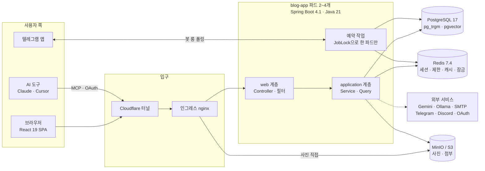
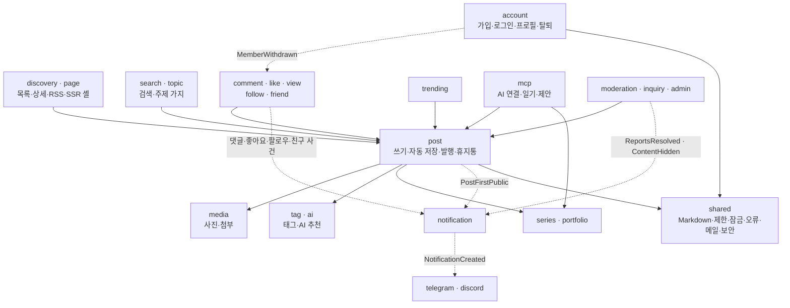
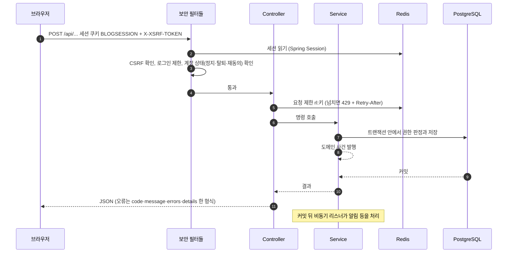

# 70 기능별 아키텍처 (팀 설명회용)

작성 2026-10-14 · 기준 [devlog v1.69.0](https://github.com/AIGJ-01-002-blog/devlog/releases/tag/v1.69.0) 코드(`main`), 마이그레이션 V1~V35, spec 001~097.

devlog의 기능을 23개로 나누어, 기능마다 **구성 그림 · 처리 흐름 그림 · 핵심 규칙 · 코드 위치 · 예상 질문**을 한 파일에 담았습니다. 팀이 한 사람씩 기능 하나를 맡아 10분 안팎으로 설명할 수 있게 파일끼리 서로 기대지 않도록 썼습니다. 이 문서(전체 구조)를 먼저 함께 보고, 그다음 순서대로 돌아가며 설명하면 됩니다.

그림은 모두 Mermaid라서 GitHub에서 바로 보입니다. 세부 규칙과 화면은 코드 저장소의 기능 명세 `specs/NNN-*`이 기준이고, 예전 설계 문서(01~66)와 숫자가 다르면 이 문서와 코드가 최신입니다.

## 설명 순서

| 순서 | 기능 | 파일 | 관련 spec |
|---|---|---|---|
| 0 | 전체 구조 (이 문서) | - | 028·030·050 |
| 1 | 가입·로그인 | [01-auth](70-feature-architecture/01-auth.md) | 001·004·038·049·065·080·083·096 |
| 2 | 블로그 주소·닉네임·프로필 | [02-profile](70-feature-architecture/02-profile.md) | 005·042·043·044 |
| 3 | 글쓰기와 자동 저장 | [03-write-autosave](70-feature-architecture/03-write-autosave.md) | 002·006·091 |
| 4 | 발행·공개 범위·본문 정화·수정 이력 | [04-publish](70-feature-architecture/04-publish.md) | 002·057·058 |
| 5 | 휴지통·내 글 관리·내보내기 | [05-trash-manage](70-feature-architecture/05-trash-manage.md) | 007·059 |
| 6 | 사진·첨부파일 | [06-media](70-feature-architecture/06-media.md) | 009·022·032·047 |
| 7 | 글 읽기 (홈·블로그·글 상세) | [07-reading](70-feature-architecture/07-reading.md) | 003·025·040·069·097 |
| 8 | RSS·사이트맵·검색엔진·광고 | [08-seo-rss-ads](70-feature-architecture/08-seo-rss-ads.md) | 026·076·085·088·090 |
| 9 | 태그와 AI 태그 추천 | [09-tags-ai](70-feature-architecture/09-tags-ai.md) | 010·018·089 |
| 10 | 검색 (키워드 + 의미 검색) | [10-search](70-feature-architecture/10-search.md) | 014·056 |
| 11 | 주제 가지와 비슷한 글 | [11-topic-branch](70-feature-architecture/11-topic-branch.md) | 072 |
| 12 | 댓글·답글 | [12-comments](70-feature-architecture/12-comments.md) | 011 |
| 13 | 좋아요·조회수·방문 통계 | [13-like-view-visit](70-feature-architecture/13-like-view-visit.md) | 012·013·027·064·066·070 |
| 14 | 트렌딩 | [14-trending](70-feature-architecture/14-trending.md) | 017 |
| 15 | 팔로우·피드·친구 | [15-follow-friend](70-feature-architecture/15-follow-friend.md) | 008·016·079 |
| 16 | 알림 (앱·텔레그램·디스코드) | [16-notification](70-feature-architecture/16-notification.md) | 015·023·078 |
| 17 | 시리즈와 포트폴리오 | [17-series-portfolio](70-feature-architecture/17-series-portfolio.md) | 024·073 |
| 18 | MCP 서버와 AI 연결 | [18-mcp](70-feature-architecture/18-mcp.md) | 051·052·053·060·086·087 |
| 19 | AI 일기·글감 제안 | [19-ai-journal](70-feature-architecture/19-ai-journal.md) | 061·071·075·088 |
| 20 | 신고·관리자·문의 | [20-moderation-admin](70-feature-architecture/20-moderation-admin.md) | 019·054·062·074 |
| 21 | 회원 탈퇴·복구 | [21-withdraw](70-feature-architecture/21-withdraw.md) | 020 |
| 22 | 화면 공통 (라우터·다국어·다크 모드·접근성) | [22-frontend-common](70-feature-architecture/22-frontend-common.md) | 021·029·031·035·055·081·095 |
| 23 | 배포·운영 | [23-deploy](70-feature-architecture/23-deploy.md) | 030·092·093 |

발표 하나당 권장 흐름: ① 사용자가 보는 화면 한 장 → ② 구성 그림 → ③ 처리 흐름 그림 → ④ 핵심 규칙 표 → ⑤ 예상 질문.

---

## 0. 전체 구조

### 0.1 한 장 요약

devlog는 **모듈러 모놀리스**입니다. Spring Boot 앱 하나가 React 화면(정적 파일)과 API를 함께 내주고, 기능은 `com.team.blog.<모듈>` 패키지로 나눕니다. 앱은 상태를 갖지 않아 여러 파드로 띄우고, 상태는 PostgreSQL·Redis·MinIO에 둡니다.

### 0.2 모듈 지도

화살표는 "부른다(의존)"이고, 점선은 도메인 사건(이벤트)으로 느슨하게 이은 것입니다.

모듈 안은 대부분 `web`(HTTP) → `application`(업무 규칙·트랜잭션) → `domain`/`infra`(엔티티·저장소·외부 연동) 세 층입니다. 글 읽기 SQL은 `post/query` 한곳에 모아(spec 050) 홈·블로그·태그·피드가 같은 카드 쿼리를 씁니다.

### 0.3 요청 하나가 지나가는 길

### 0.4 모두가 함께 쓰는 장치

| 장치 | 위치 | 하는 일 |
|---|---|---|
| 세션 | Spring Session + Redis (`blog:session`, 14일) | 파드 여러 개가 같은 로그인을 앎. Redis가 죽으면 `ResilientSessionFilter`가 비로그인으로 처리 |
| 요청 제한 | `shared/web/RateLimiter` | Redis 고정 창(Lua `INCR`+`PEXPIRE`), 키 `rl:*`. Redis가 죽으면 통과(fail-open) |
| 예약 작업 잠금 | `shared/scheduling/JobLock` | `SET lock:job:<이름> NX PX`, 토큰 비교 후 삭제. 못 잡으면 그 회차는 건너뜀 |
| 오류 형식 | `shared/error/GlobalExceptionHandler` | `ErrorResponse(code, message, errors[], details)` |
| 존재를 감추는 404 | `post/access/PostAccessPolicy` | 못 보는 글·남의 리소스는 "없는 것"과 같은 404 |
| 본문 정화 | `shared/markdown/ContentRenderer` | Markdown → HTML → OWASP 허용 목록 |
| 메일 | `shared/mail` | SMTP가 설정되면 비동기 발송, 아니면 개발용 보관함 |
| 보안 헤더 | `config/SecurityConfig`, `config/ContentSecurityPolicy` | 필터 체인 3개(정적·MCP·본체), CSP, Referrer-Policy |

### 0.5 예약 작업 한눈에 (모두 한국 시간)

| 작업 | 주기 | 하는 일 | 설명 파일 |
|---|---|---|---|
| `AutosaveFlushJob` | 60초마다 | Redis 자동 저장분을 DB로 | 03 |
| `ViewFlushJob` | 60초마다 | Redis에 모은 조회수를 DB로 | 13 |
| `EmbeddingIndexJob` | 60초마다 | 공개 글 20개씩 임베딩 | 10 |
| `TelegramBot` | 1초 간격 롱 폴링 | 텔레그램 메시지 받기 | 16 |
| `TrendingService` | 10분마다 | 트렌딩 스냅숏 | 14 |
| `TopicIndexJob` | 10분마다 | 주제 묶기 | 11 |
| `AiDiaryJob` | 매시 정각 | 그 시각을 고른 회원의 AI 일기 | 19 |
| `ProfileImageCleanupJob` | 매시 17분 | 안 쓰는 프로필 사진 | 06 |
| `PostImageCleanupJob` | 03:40 | 안 쓰는 글 사진·첨부 | 06 |
| `EmptyDraftCleanupJob` | 04:00 | 빈 임시글 | 03 |
| `TrashPurgeJob` | 04:30 | 30일 지난 휴지통 | 05 |
| `NotificationCleanupJob` | 04:30 | 90일 지난 알림 | 16 |
| 방문·활동 기록 정리 | 04:40 · 04:45 | 400일 지난 통계 | 13 |
| `WithdrawalPurgeJob` | 04:50 | 30일 지난 탈퇴 회원 | 21 |
| `ReportPurgeJob` | 05:10 | 처리 30일 지난 신고 내용 | 20 |

### 0.6 도메인 사건 한눈에

| 사건 | 내는 곳 | 받는 곳 |
|---|---|---|
| `PostFirstPublic` | post (처음 공개될 때) | notification → 팔로워·시리즈 구독자에게 새 글 알림 |
| `CommentCreated` / `CommentDeleted` | comment | notification |
| `PostLiked` / `PostUnliked` | like | notification |
| `Followed` / `Unfollowed` | follow | notification |
| `FriendRequested` / `FriendAccepted` | friend | notification |
| `ReportsResolved` / `ContentHidden` | moderation | notification |
| `NotificationCreated` | notification | telegram, discord (보내기) |
| `MemberWithdrawn` | account | friend (친구 관계 바로 삭제) |
| `AutosaveCleanup` / `PostPurged` | post | post (Redis 자동 저장분 정리) |

알림 리스너는 모두 `@Async` + `@TransactionalEventListener`라서 **커밋된 뒤에, 다른 스레드에서** 처리합니다. 알림이 실패해도 댓글·좋아요 같은 본래 요청은 성공합니다.

### 0.7 데이터 저장소 역할

| 저장소 | 담는 것 |
|---|---|
| PostgreSQL | 회원·글·댓글·태그·좋아요·조회 기록·알림·시리즈·신고 등 원본. Flyway V1~V35 |
| Redis | 세션, 요청 제한, 자동 저장 버퍼, 조회수 버퍼, 렌더링 캐시, 멱등 키, AI 결과·한도, 트렌딩 스냅숏, 작업 잠금 |
| MinIO / S3 | 사진 원본·썸네일, 첨부파일, 프로필 사진 (없으면 로컬 폴더) |

Redis에 있는 것은 모두 "잃어도 다시 만들 수 있거나, 잠깐 늦어져도 되는 것"이라는 원칙입니다. 그래서 Redis가 죽으면 기능이 꺼지거나 느려질 뿐 원본 데이터는 잃지 않습니다.
