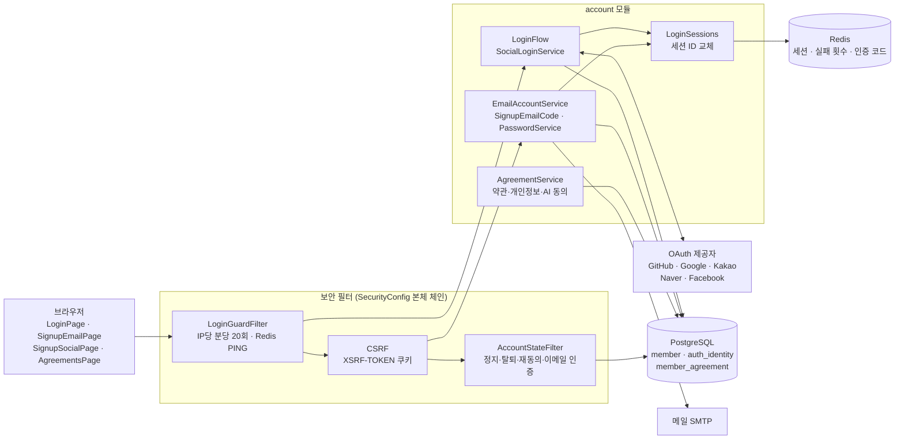
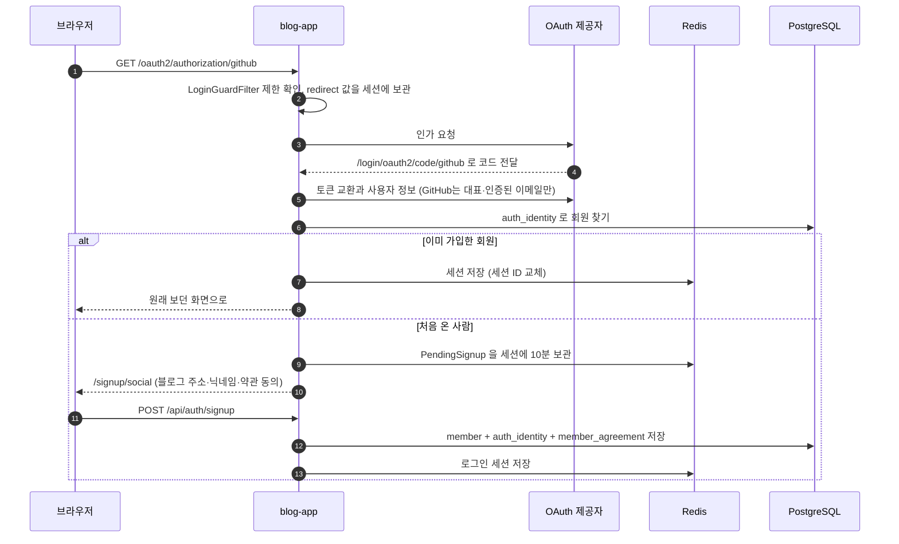
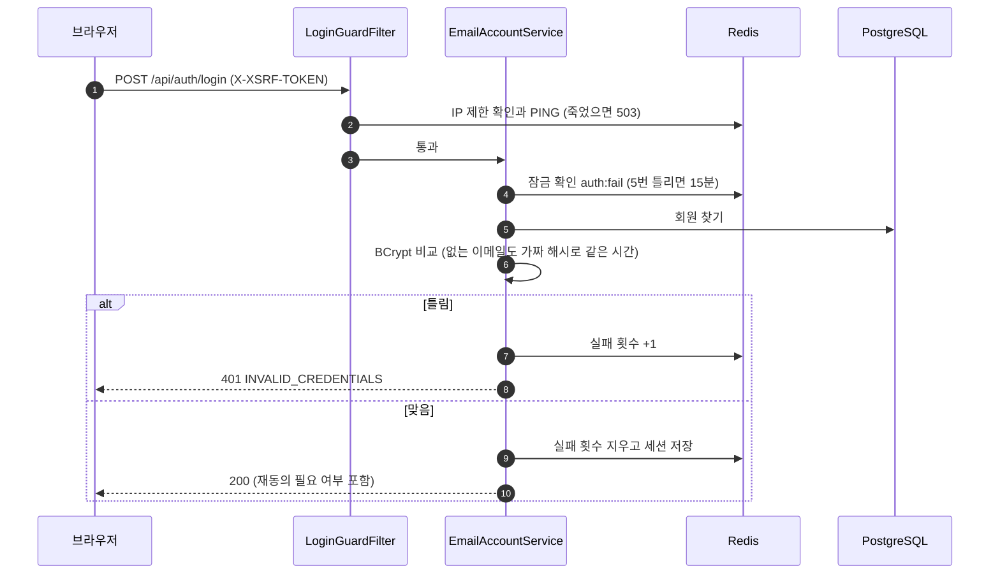

# 1. 가입·로그인

[← 기능별 아키텍처 목차](../70-feature-architecture.md)

**한 줄 요약**: 소셜 로그인 5종(GitHub·Google·카카오·네이버·Facebook)과 이메일 가입을 받고, 로그인 상태는 Redis에 둔 서버 세션 쿠키로 유지합니다. 모든 API 요청은 필터에서 계정 상태(정지·탈퇴·재동의·이메일 인증)를 다시 확인합니다.

## 구성

## 처리 흐름: 소셜 로그인 → 처음이면 가입 마무리

## 처리 흐름: 이메일 로그인

## 핵심 규칙

| 항목 | 규칙 |
|---|---|
| 세션 | Redis `blog:session`, 14일, 쿠키 `BLOGSESSION`(HttpOnly, SameSite=Lax). 회원별 색인이 있어 탈퇴·정지 때 모든 기기 로그아웃 |
| CSRF | `XSRF-TOKEN` 쿠키 → `X-XSRF-TOKEN` 헤더 (`csrf.spa()`) |
| 소셜 켜기 | Google·카카오·Facebook·네이버는 `*_CLIENT_ID`가 있을 때만 켜짐 |
| 이메일 가입 코드 | 6자리, 10분, 5번까지 시도. 분당 1회·하루 10회·IP 시간당 20회 |
| 비밀번호 | BCrypt 10. 재설정 링크 30분, 인증 링크 24시간, 회원당 마지막 링크만 유효 |
| 로그인 잠금 | 같은 이메일 5번 실패 → 15분 |
| 계정 상태 | 정지 → 쓰기 403 `ACCOUNT_SUSPENDED`, 탈퇴 신청 → 403 `ACCOUNT_WITHDRAWN`, 새 약관 → 403 `AGREEMENT_REQUIRED`, 이메일 미인증 → 쓰기 403 `EMAIL_NOT_VERIFIED` |
| 약관 | 약관 2026-10-07판, 개인정보 2026-10-10판. 판이 바뀌면 다시 동의 |
| 관리자 API | `/api/admin/**`는 운영진이 아니면 404 (있는 줄도 모르게) |

## 코드 위치

- 백엔드: `config/SecurityConfig`, `account/web/{AuthController, EmailAuthController, LoginGuardFilter, AccountStateFilter, LoginFlow}`, `account/application/{SocialLoginService, EmailAccountService, SignupEmailCode, PasswordService, AgreementService}`, `account/infra/oauth/*`, `shared/security/*`
- 화면: `pages/{LoginPage, SignupEmailPage, SignupSocialPage, AgreementsPage, ForgotPasswordPage, ResetPasswordPage, VerifyEmailPage}`, `lib/auth.tsx`, `App.tsx`의 `AgreementGate`
- 테이블: `member`, `auth_identity`, `member_agreement` (V1), 로그인 수단 추가 V30·V31·V34

## 예상 질문

- **왜 JWT가 아니라 세션인가요?** 탈퇴·정지 때 모든 기기를 바로 끊어야 하고, 브라우저에서는 HttpOnly 쿠키가 토큰 탈취에 더 강해서입니다. 파드가 여러 개여도 세션을 Redis에 두어 어느 파드든 같은 사용자를 압니다.
- **없는 이메일로 로그인하면 더 빨리 실패하지 않나요?** 가짜 해시와도 BCrypt 비교를 해서 응답 시간이 같습니다. 가입 여부를 시간으로 알아낼 수 없습니다.
