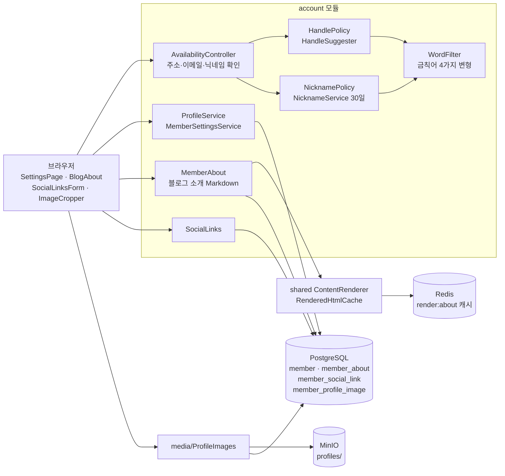
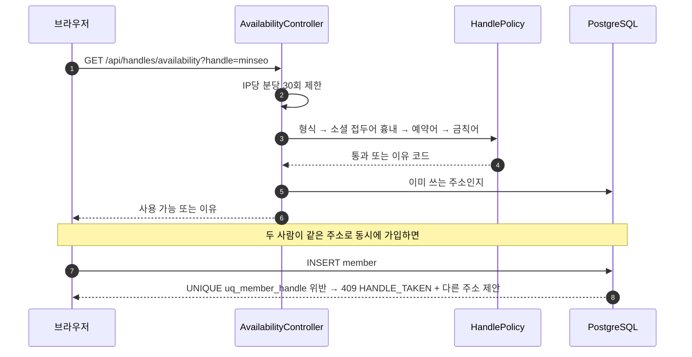

# 2. 블로그 주소·닉네임·프로필

[← 기능별 아키텍처 목차](../70-feature-architecture.md)

**한 줄 요약**: 블로그 주소(`/@handle`)는 가입 때 한 번 정하고 바꾸지 않으며, 닉네임·자기소개·프로필 사진·블로그 소개·소셜 링크는 설정에서 고칩니다. 이름 규칙은 정책 클래스 하나에 모으고 DB CHECK로 한 번 더 지킵니다.

## 구성

## 처리 흐름: 블로그 주소 확인과 가입 시 경쟁

## 핵심 규칙

| 항목 | 규칙 |
|---|---|
| 블로그 주소 | 영문 소문자·숫자·밑줄 3~20자. 소셜 가입은 `go-`·`gi-`·`ka-`·`fb-`·`nv-` 접두어. 이메일 가입은 `go_` 같은 흉내 금지. 같은 규칙을 DB CHECK(V34)로도 지킴 |
| 닉네임 | 한글·영문·숫자 2~10자, 글자 하나 이상. 바꾼 뒤 30일 동안 다시 못 바꿈 |
| 금칙어 | 소문자화 후 원문·숫자 뺀 것·숫자→글자·1→l 네 가지로 검사. 예외 목록 따로 |
| 자기소개 | 200자, 4줄 |
| 블로그 소개 | Markdown 10,000자, 글과 같은 렌더러·정화. Redis에 7일 캐시 |
| 소셜 링크 | 이메일·GitHub·X·Facebook·홈페이지. 아이디만 저장, http(s)만 |
| 바꿀 수 없는 것 | 블로그 주소, 가입 이메일, 로그인 수단 |

## 코드 위치

- 백엔드: `account/web/{AvailabilityController, MeController, AboutController, SocialLinksController}`, `account/application/{HandlePolicy, HandleSuggester, NicknamePolicy, NicknameService, WordFilter, BioPolicy, ProfileService, MemberSettingsService, MemberAbout, SocialLinks}`, `media/ProfileImages`
- 화면: `pages/SettingsPage`, `components/{BlogAbout, SocialLinksForm, SocialLinkList, ImageCropper}`, `lib/socialLinks.ts`
- 테이블: `member`(V1), `member_profile_image`(V3), `member_about`(V9), `member_social_link`(V10)
- 금칙어 목록: `resources/policy/banned-words.txt`, `banned-words-exceptions.txt`

## 예상 질문

- **사용 가능 확인을 했는데 왜 가입에서 실패할 수 있나요?** 확인과 저장 사이에 다른 사람이 먼저 가질 수 있어서입니다. 최종 판정은 DB UNIQUE 제약이 하고, 진 쪽에는 다른 주소를 제안합니다.
- **블로그 주소는 왜 못 바꾸나요?** 글 주소(`/@handle/posts/id`)와 RSS·외부 링크가 모두 깨지기 때문입니다.
