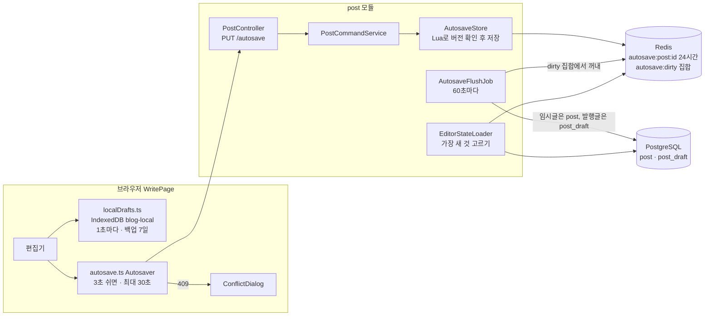
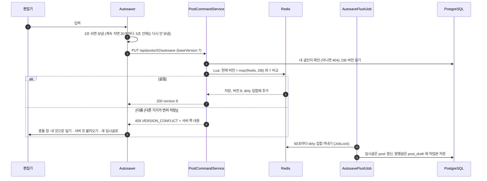

# 3. 글쓰기와 자동 저장

[← 기능별 아키텍처 목차](../70-feature-architecture.md)

**한 줄 요약**: 쓰는 글은 브라우저 IndexedDB에 1초마다, 서버 Redis에 몇 초마다 저장되고, 서버는 1분마다 Redis 내용을 DB로 옮깁니다. 두 기기에서 동시에 고치면 편집 버전으로 충돌을 잡아 사용자가 고르게 합니다.

## 구성: 저장이 세 겹

## 처리 흐름: 자동 저장과 충돌

## 핵심 규칙

| 항목 | 규칙 |
|---|---|
| 크기 | 제목 100자, 본문 100,000자, 요청 1MB |
| 서버 자동 저장 | 글마다 5초에 1번, Redis 24시간 보관 |
| 실패 재시도 | 2초 → 4초 → … 최대 60초, 흔들림(jitter) 추가. 탭을 닫을 때 `keepalive`로 마지막 저장 |
| 오프라인 | IndexedDB `drafts`·`backups`(7일)·`pendingImages`. 다시 연결되면 바로 재시도 |
| 발행한 글 고치기 | 독자가 보는 발행본은 그대로 두고 `post_draft`(작업본)에 저장. 다시 발행해야 공개 |
| 편집 상태 불러오기 | 자동 저장분·작업본·발행본 중 버전이 가장 높은 것 |
| 빈 임시글 | [새 글]은 빈 임시글이 있으면 재사용. 내용이 하나도 없으면 휴지통 없이 바로 지움(`DELETE /if-empty`). 매일 04:00에 24시간 지난 빈 임시글 정리 |
| Redis 장애 | 자동 저장 대신 DB 행 잠금과 DB 버전으로 판정 |

## 코드 위치

- 백엔드: `post/web/PostController`, `post/application/{PostCommandService, AutosaveFlushJob, EditorStateLoader, AutosaveCleanupListener, EmptyDraftCleanupJob}`, `post/infra/AutosaveStore`
- 화면: `pages/WritePage`, `lib/{autosave.ts, localDrafts.ts, trash.ts}`, `components/{ConflictDialog, MarkdownToolbar}`
- 테이블: `post`(`edit_version`), `post_draft` (V1)

## 예상 질문

- **매 입력마다 DB에 쓰면 안 되나요?** 입력이 많은 기능이라 Redis에 모아 1분마다 한 번 옮깁니다. DB 쓰기를 크게 줄이고, 파드가 죽어도 Redis에 24시간 남습니다.
- **같은 글을 노트북과 휴대폰에서 동시에 고치면?** 늦게 보낸 쪽이 409를 받고, 서버 내용을 보여 주며 셋 중 하나를 고르게 합니다. 말없이 덮어쓰지 않습니다.
