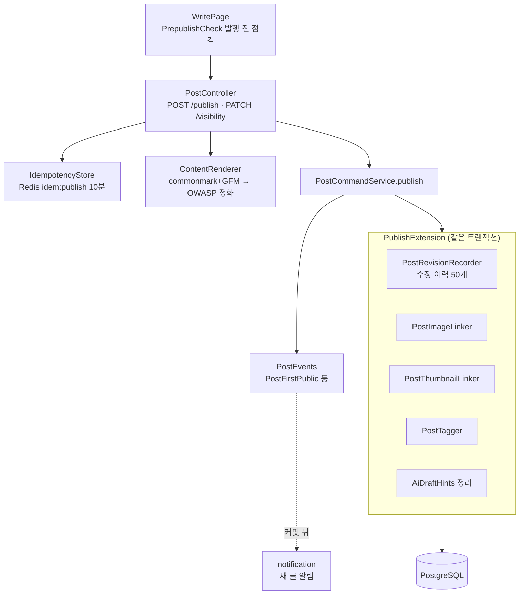
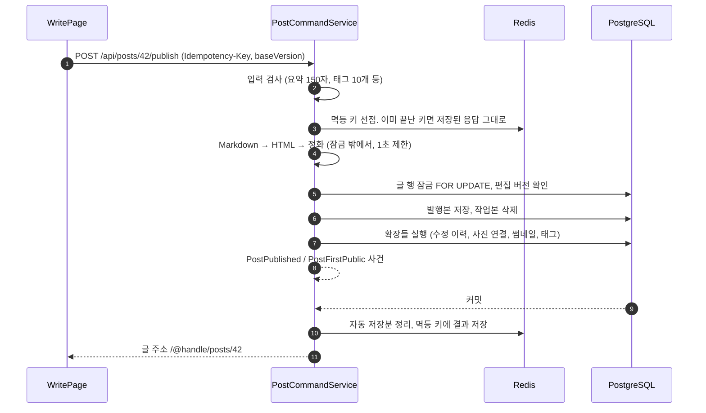
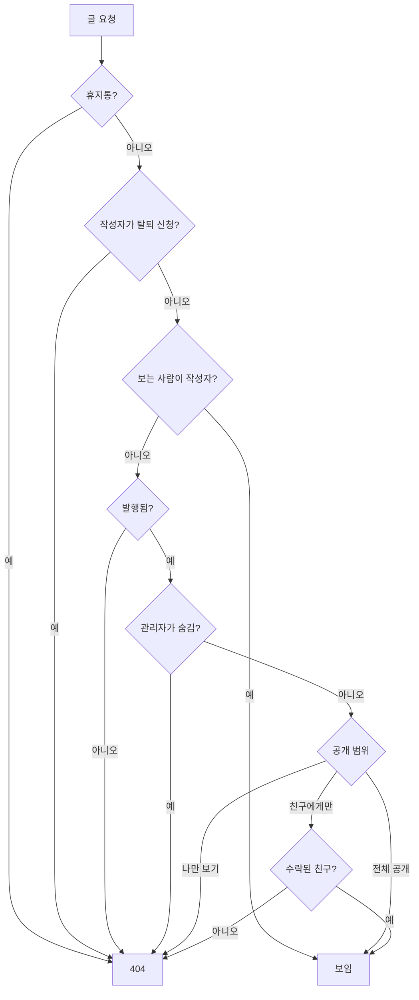

# 4. 발행·공개 범위·본문 정화·수정 이력

[← 기능별 아키텍처 목차](../70-feature-architecture.md)

**한 줄 요약**: 발행하면 서버가 Markdown을 HTML로 바꾸고 허용 목록으로 정화한 뒤, 한 트랜잭션 안에서 글·태그·사진·썸네일·수정 이력을 함께 저장합니다. 같은 발행이 두 번 와도 멱등 키로 한 번만 처리하고, 볼 권한이 없는 글은 "없는 글"과 같은 404로 감춥니다.

## 구성

## 처리 흐름: 발행

## 처리 흐름: 누가 이 글을 볼 수 있나

## 핵심 규칙

| 항목 | 규칙 |
|---|---|
| 정화 | 제목 단계 한 칸 내림, 원본 HTML은 글자로, 남의 사진·외부 사진은 링크로, GIF는 첫 장면+링크, 중첩 20단계, 렌더링 1초 제한. `RENDER_VERSION` 4 |
| 렌더링 캐시 | Redis `render:post:{id}:{편집버전}:{렌더버전}` 7일. 렌더러를 바꾸면 버전을 올려 한꺼번에 새로 |
| 멱등 | 같은 키·다른 내용 → 422 `IDEMPOTENCY_KEY_REUSED`, 처리 중 → 409 |
| 공개 범위 | 전체 공개 · 친구에게만(V4) · 나만 보기. 규칙은 `VisibilityRule` 구현으로 끼워 넣음 |
| 404 원칙 | "없음"과 "권한 없음"을 구분하지 않음 |
| 발행 전 점검 | 요약·태그·썸네일·사진 대체 글·본문 200자 미만·제목 반복·닫히지 않은 코드 블록·빈 링크 |
| 수정 이력 | 발행할 때마다 `post_revision`에 남기고 글마다 50개 보관. `GET /revisions` |
| 새 글 알림 | 처음 공개될 때 한 번만(`PostFirstPublic`) |

## 코드 위치

- 백엔드: `post/application/{PostCommandService, PublishCommand}`, `post/infra/IdempotencyStore`, `post/access/{PostAccessPolicy, BuiltInVisibilityRules}`, `friend/application/FriendsVisibilityRule`, `shared/markdown/{ContentRenderer, RenderedHtmlCache}`, `revision/*`
- 화면: `pages/WritePage`, `components/{PrepublishCheck, RevisionHistory}`, `lib/{prepublish.ts, revisions.ts, visibility.ts}`
- 테이블: `post`, `post_draft`, `post_tag`, `post_image`, `post_thumbnail`(V12), `post_revision`(V17)

## 예상 질문

- **왜 서버에서 렌더링하나요?** 정화를 서버 한곳에서 해야 우회할 수 없습니다. 화면은 이미 정화된 HTML만 받습니다.
- **확장(PublishExtension)으로 나눈 이유는?** 태그·사진·이력 모듈이 post 모듈 코드를 고치지 않고 발행에 끼어들 수 있게 하려는 것입니다. 모두 같은 트랜잭션이라 하나라도 실패하면 발행 전체가 취소됩니다.
