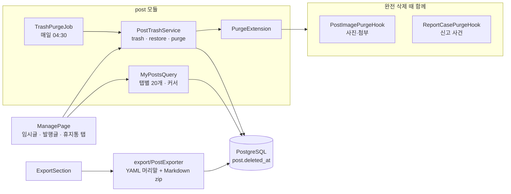
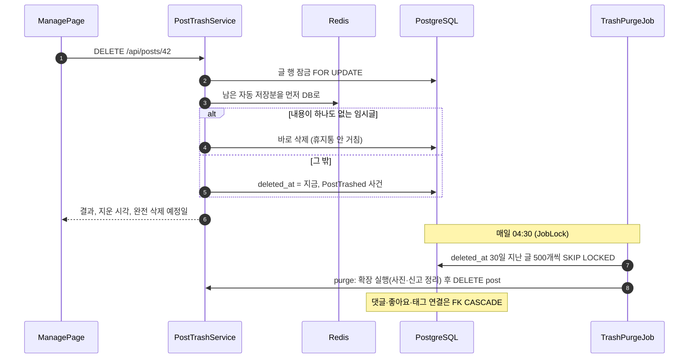

# 5. 휴지통·내 글 관리·내보내기

[← 기능별 아키텍처 목차](../70-feature-architecture.md)

**한 줄 요약**: 지운 글은 30일 동안 휴지통에 있다가 새벽 작업이 완전히 지웁니다. 내 글 관리 화면은 임시글·발행글·휴지통 탭을 한 쿼리로 세어 보여 주고, 내 글 전체를 Markdown zip으로 내보낼 수 있습니다.

## 구성

## 처리 흐름: 휴지통으로 → 30일 뒤 완전 삭제

## 핵심 규칙

| 항목 | 규칙 |
|---|---|
| 보관 | 30일. 그 안에는 언제든 복구(`POST /restore`) |
| 바로 완전 삭제 | 휴지통에서 `DELETE /permanent` |
| 삭제 이유 | `PostPurged.reason` = USER · EXPIRED · EMPTY · WITHDRAW |
| 요청 제한 | 지우기·복구·완전 삭제 모두 분당 60회 |
| 내 글 목록 | 탭 3개, 20개씩, `updated_at` 순(휴지통은 `deleted_at` 순). 개수는 `FILTER` 한 쿼리. 고치는 중인 글 표시 |
| 내보내기 | 휴지통 밖 내 글 전부. 글마다 Markdown 파일 + YAML 머리말(제목·날짜·태그·시리즈·주소). Hugo·Jekyll·Gatsby로 옮기기 쉽게. 발행글은 발행본, 임시글은 마지막 저장분 |

## 코드 위치

- 백엔드: `post/application/{PostTrashService, TrashPurgeJob, MyPostsQuery}`, `post/web/MyPostsController`, `media/PostImagePurgeHook`, `moderation/ReportCasePurgeHook`, `export/*`
- 화면: `pages/ManagePage`, `components/ExportSection`, `lib/{trash.ts, export.ts}`
- API: `GET /api/me/posts?tab&visibility&cursor`, `GET /api/me/export`, `GET /api/me/export.zip`

## 예상 질문

- **완전 삭제 때 사진은 어떻게 되나요?** `PostImagePurgeHook`이 글과 연결이 끊긴 사진을 표시하고, 사진 정리 작업이 7일 뒤 저장소에서 지웁니다(06 참고).
- **여러 파드가 동시에 정리 작업을 돌리면?** `JobLock`으로 한 파드만 돌고, 행은 `SKIP LOCKED`로 잡아 사용자의 복구 요청과 부딪히지 않습니다.
