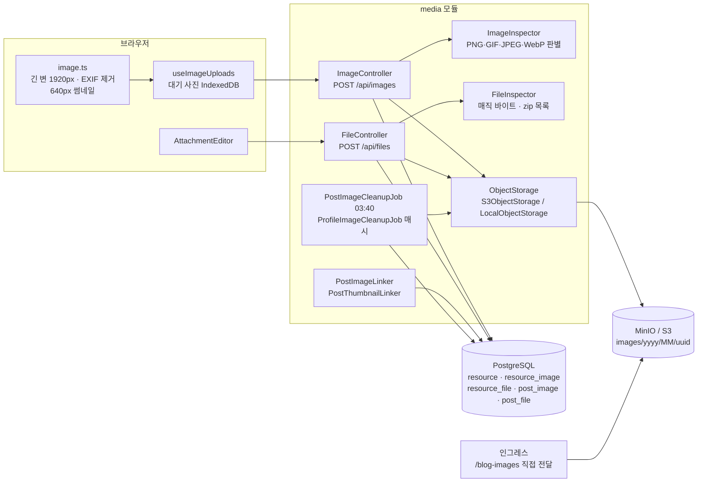
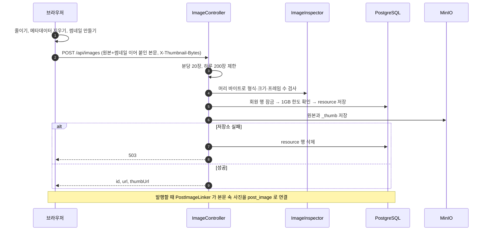

# 6. 사진·첨부파일

[← 기능별 아키텍처 목차](../70-feature-architecture.md)

**한 줄 요약**: 브라우저가 사진을 줄이고 메타데이터를 지운 뒤 썸네일과 함께 올리면, 서버는 파일 머리 바이트로 진짜 형식을 확인하고 용량 한도 안에서 MinIO에 저장합니다. 사진은 발행할 때 글에 연결되고, 연결되지 않은 파일은 새벽 작업이 정리합니다.

## 구성

## 처리 흐름: 사진 올리기

## 핵심 규칙

| 항목 | 규칙 |
|---|---|
| 사진 | 원본 10MB, 썸네일 1MB·640px. 일반 사진은 변 10,000px 이하에 EXIF·XMP 없어야 함. GIF는 1920px·300프레임 |
| 형식 판별 | 요청의 Content-Type은 믿지 않고 파일 머리 바이트로 |
| 용량 | 회원당 1GB, 회원 행 잠금 아래서 확인. `GET /api/me/storage` |
| 첨부파일 | 20MB, pdf·zip·txt·md·csv·docx·xlsx·pptx, 글당 20개. 받기는 늘 `attachment`로, 글을 볼 수 있을 때만 |
| 저장소 | `S3_ENDPOINT`가 있으면 MinIO/S3, 없으면 로컬 폴더(`/media/**`) |
| 버킷 공개 | 익명은 `images/`·`profiles/` 파일 받기만, 목록 조회 금지 |
| 정리 | 한 번도 안 쓴 파일 24시간 뒤, 글에서 빠진 파일 7일 뒤 삭제(매일 03:40). 프로필 사진은 매시 17분 |

## 코드 위치

- 백엔드: `media/{ImageController, FileController, PostImages, PostFiles, ImageInspector, FileInspector, PostImageLinker, PostThumbnailLinker, PostImageCleanupJob, ProfileImageCleanupJob}`, `media/storage/*`
- 화면: `lib/{image.ts, postImages.ts, useImageUploads.ts, files.ts, gifPlayer.ts}`, `components/{AttachmentEditor, AttachmentList, ThumbnailPicker, ImageZoom}`
- 테이블: `resource`(V3에서 `image`를 이름 바꿈), `resource_image`, `resource_file`, `post_image`, `post_file`(V3), `post_thumbnail`(V12)

## 예상 질문

- **왜 multipart가 아닌가요?** 원본과 썸네일 두 덩어리만 보내면 되어서, 본문에 이어 붙이고 썸네일 길이를 헤더로 알려 줍니다. 파싱이 단순하고 크기 제한을 정확히 걸 수 있습니다.
- **비공개 글의 사진 주소를 알면 볼 수 있나요?** 네, 주소를 아는 사람은 받을 수 있습니다. 대신 버킷 목록 조회를 막아 주소를 찾아낼 수는 없게 했습니다.
