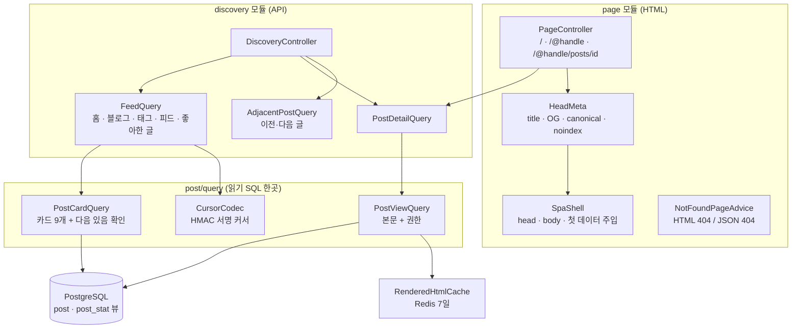
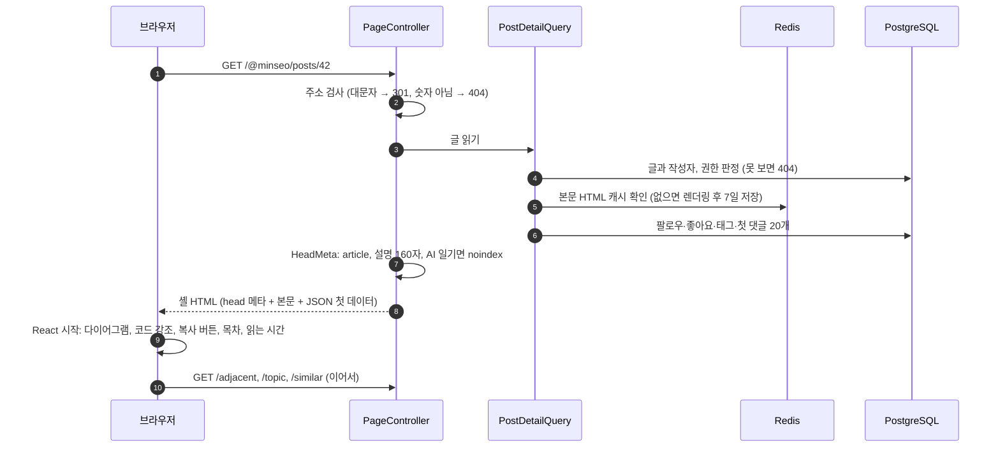
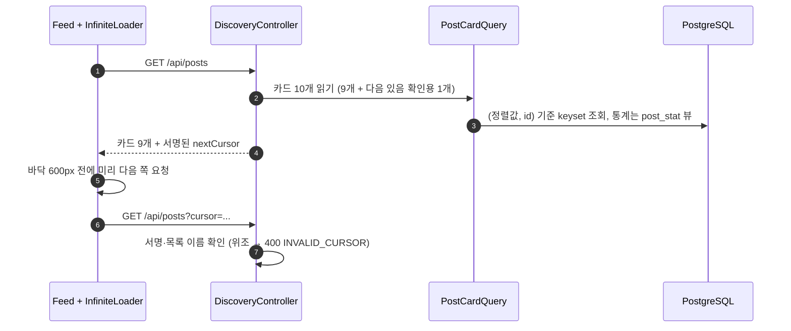

# 7. 글 읽기 (홈·블로그·글 상세)

[← 기능별 아키텍처 목차](../70-feature-architecture.md)

**한 줄 요약**: 서버가 HTML 셸에 제목·OG 태그·JSON-LD·본문 HTML·첫 데이터를 넣어 보내고(SSR 셸), React가 그 위에서 화면을 이어 받습니다. 목록은 카드 쿼리 하나와 서명된 커서로 무한 스크롤합니다.

## 구성

## 처리 흐름: 글 상세 화면 열기

## 처리 흐름: 무한 스크롤

## 핵심 규칙

| 항목 | 규칙 |
|---|---|
| 카드 | 한 쪽 9개, 요약은 본문 앞 600자에서, 태그는 배열 서브쿼리로 한 번에 |
| 커서 | Base64URL JSON + HMAC-SHA256 12바이트 서명, 512자 이하. 목록 이름(`home`, `blog:{id}`, `tag:x`)이 들어 있어 다른 목록에 못 씀 |
| 이전·다음 글 | 친구는 `published_at`, 그 밖은 `first_public_at` 순 |
| 캐시 헤더 | 친구 공개 글이 섞인 목록은 `no-store, private`, 공개 목록은 `no-cache` |
| 셸 주입 | 첫 데이터는 실행되지 않는 `application/json` 블록이라 CSP와 맞음 |
| 404 | 화면 요청(GET, `/api` 밖, 확장자 없음, `Accept: text/html`)은 HTML 404, 그 밖은 JSON 404 |
| 읽기 도우미 | 목차는 제목 2개부터, 읽는 시간은 분당 500자 + 사진당 10초. 최근 읽은 글 50개는 브라우저에만 |
| 다이어그램 | 본문에 `mermaid` 코드 블록이 있을 때만 mermaid를 불러와 `strict` 모드로 그림 |

## 코드 위치

- 백엔드: `page/{PageController, SpaShell, HeadMeta, NotFoundPageAdvice}`, `discovery/{web/DiscoveryController, application/FeedQuery, PostDetailQuery, AdjacentPostQuery}`, `post/query/*`, `shared/cursor/CursorCodec`
- 화면: `pages/{HomePage, BlogPage, PostPage}`, `components/{Feed, InfiniteLoader, PostCard, Toc, ReadProgress, AdjacentPosts, ShareButton}`, `lib/{toc.ts, postEnhance.ts, diagram.ts, highlight.ts, share.ts, recentReads.ts}`

## 예상 질문

- **SPA인데 검색엔진과 링크 미리보기는 어떻게 되나요?** 서버가 셸에 제목·설명·OG·JSON-LD와 본문 HTML을 넣어 보내서, 자바스크립트를 실행하지 않는 수집기도 내용을 봅니다.
- **OFFSET 대신 커서를 쓰는 이유는?** 새 글이 올라와도 다음 쪽에서 글이 겹치거나 빠지지 않고, 뒤쪽으로 갈수록 느려지지 않습니다.
