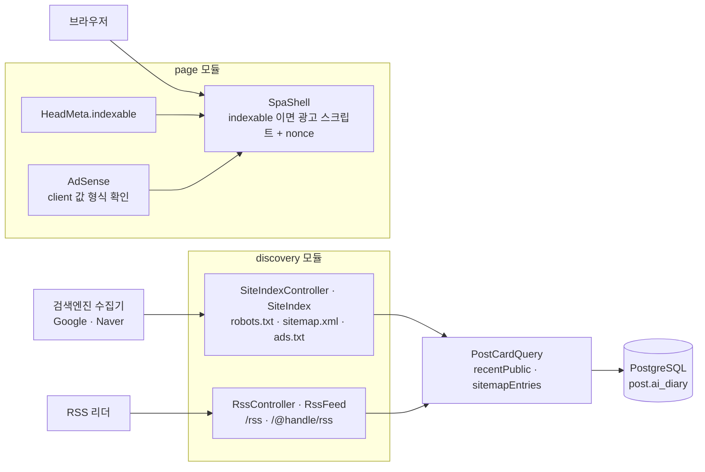
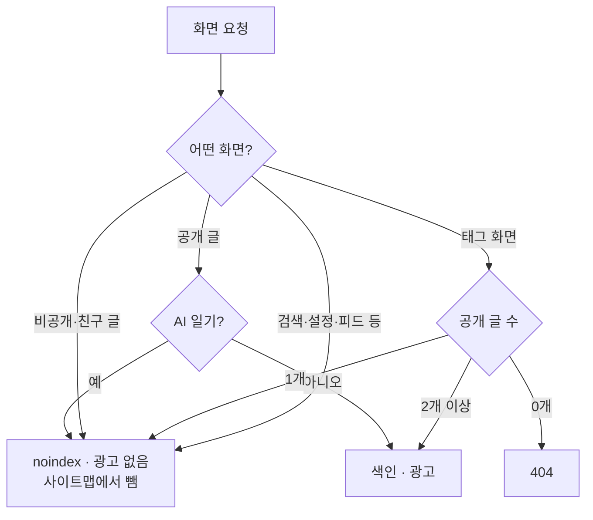

# 8. RSS·사이트맵·검색엔진·광고

[← 기능별 아키텍처 목차](../70-feature-architecture.md)

**한 줄 요약**: 검색엔진에는 공개 글만 보여 주고(robots·사이트맵·noindex), 구독자에게는 RSS를, 색인되는 화면에만 AdSense 광고를 붙입니다. "색인해도 되는 화면인가"라는 한 가지 판단(`HeadMeta.indexable`)이 noindex와 광고를 함께 정합니다.

## 구성

## 판단 흐름: 이 화면을 색인하고 광고를 붙일까

## 핵심 규칙

| 항목 | 규칙 |
|---|---|
| RSS | RSS 2.0, 최신 20개, 요약만. 10분 캐시. 브라우저로 열면 안내 화면(`?format=xml`이면 XML) |
| robots.txt | `/api/`·`/write`·`/settings`·`/manage/`·`/admin`·`/notifications`·`/feed`·`/lists/`·로그인·가입 화면 막음, 사이트맵 주소 안내. 1시간 캐시 |
| sitemap.xml | 홈·소개·약관·`/mcp`·`/releases`·모든 블로그·공개 글(최대 40,000). AI 일기 제외. 30분 캐시. robots의 막은 경로와 겹치지 않게 테스트로 지킴 |
| AI 일기 | `post.ai_diary`(V32). 독자에게는 보이지만 noindex·광고 없음·사이트맵 제외 |
| 광고 | `blog.adsense.client`가 `ca-pub-` 형식일 때만 켬. 자동 광고, 고정 자리 없음. 광고 화면은 nonce + `strict-dynamic` CSP |
| 얕은 화면 | 공개 글 2개 미만 태그는 noindex, 0개면 404(소프트 404 방지) |

## 코드 위치

- 백엔드: `discovery/web/{RssController, SiteIndexController}`, `discovery/application/{RssFeed, SiteIndex}`, `page/{HeadMeta, AdSense, SpaShell}`, `config/ContentSecurityPolicy`
- 화면: `pages/RssGuidePage`, `lib/rss.ts`

## 예상 질문

- **AI 일기는 왜 색인에서 뺐나요?** 자동으로 매일 만들어지는 글이 많아지면 검색엔진이 사이트 전체를 "가치가 낮다"고 볼 수 있어서입니다. 독자에게는 그대로 보입니다.
- **광고 스크립트가 CSP와 부딪히지 않나요?** 광고가 붙는 화면만 요청마다 nonce를 만들어 `strict-dynamic`으로 허용하고, 나머지 화면은 `script-src 'self'` 그대로입니다.
