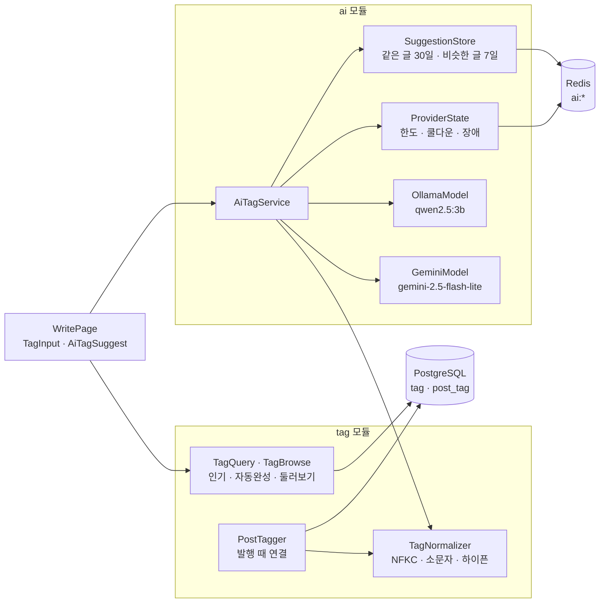
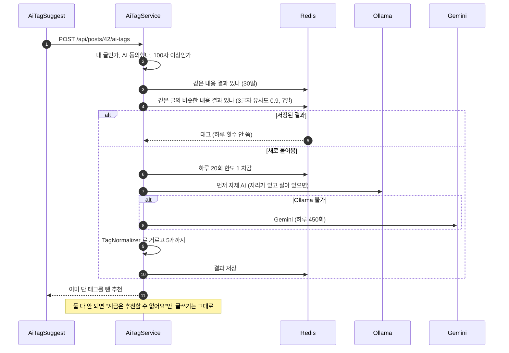

# 9. 태그와 AI 태그 추천

[← 기능별 아키텍처 목차](../70-feature-architecture.md)

**한 줄 요약**: 태그는 정규화 규칙 하나로 같은 태그를 하나로 모으고, 발행 트랜잭션 안에서 연결합니다. AI 태그 추천은 자체 서버 AI(Ollama)와 Google Gemini를 번갈아 쓰고, 같은·비슷한 글은 저장된 결과로 답해 한도를 아낍니다.

## 구성

## 처리 흐름: AI 태그 추천

## 핵심 규칙

| 항목 | 규칙 |
|---|---|
| 정규화 | NFKC → 앞 `#` 제거 → 소문자 → 공백은 `-` → 허용 글자 `[가-힣a-z0-9._+#-]` → 30자 → 금칙어. DB CHECK `ck_tag_name`과 같은 규칙 |
| 글당 태그 | 10개. 저장은 정렬해서 `INSERT … ON CONFLICT`(교착 방지) |
| 둘러보기 | `/tags` 인기·이름·최근 순, 태그마다 인기 글 10개(트렌딩과 같은 무게 3·2·0.1) |
| 자동완성 | 앞글자 일치 10개, 분당 60회 |
| AI 순서 | 기본 `local`: Ollama 먼저, 안 되면 Gemini. `gemini`로 바꾸면 Gemini 먼저, 한도 초과 때만 Ollama |
| 한도 | 회원 하루 20회(저장된 답은 안 셈, 바쁨 오류는 돌려줌), 분당 30회 |
| 장애 표시 | Gemini 한도 소진·60초 쿨다운, Ollama 60초 장애 표시를 Redis에 둠 |
| 프롬프트 | 사이트 인기 태그 50개를 함께 줌(하루 캐시) |

## 코드 위치

- 백엔드: `tag/{web/TagController, application/TagNormalizer, PostTagger, TagQuery, TagBrowse}`, `ai/{web/AiTagController, application/AiTagService, SuggestionStore, ProviderState, AiInput, TagPrompt, MemoDraftService, infra/OllamaModel, GeminiModel}`
- 화면: `components/{AiTagSuggest, TagInput, TagRow}`, `pages/{TagsPage, TagPage}`, `lib/{aiTags.ts, tags.ts}`
- 테이블: `tag`, `post_tag` (V1). AI 동의는 `member_agreement`의 `AI`

## 예상 질문

- **AI가 이상한 태그를 주면?** AI 답도 사람이 쓴 태그와 같은 `TagNormalizer`·금칙어를 거치고, 사용자가 눌러야 붙습니다.
- **왜 AI를 두 개 쓰나요?** 무료 Gemini는 하루 한도가 있고, 자체 Ollama는 느리고 동시에 하나만 처리합니다. 서로 빈 곳을 메웁니다.
