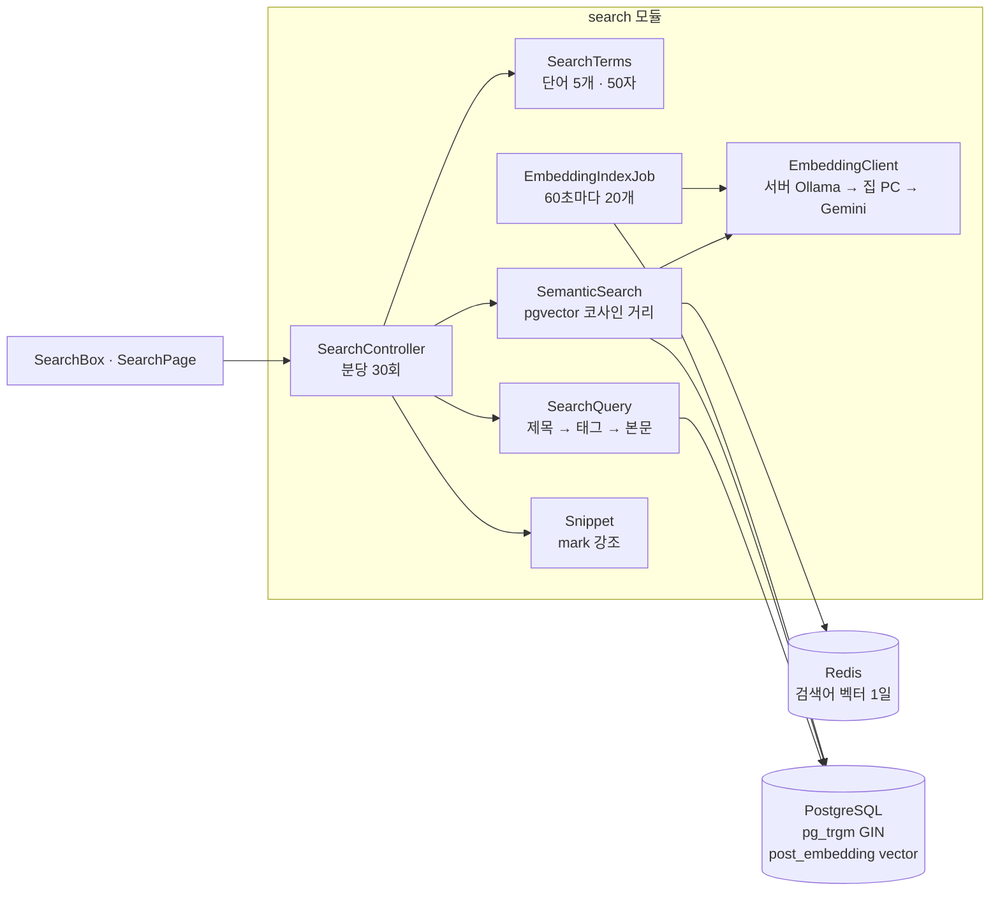
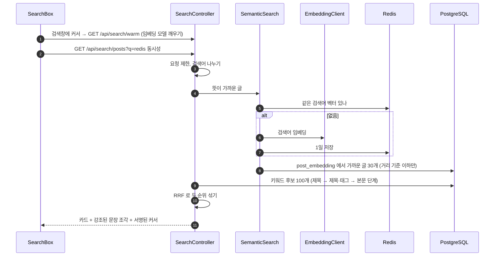
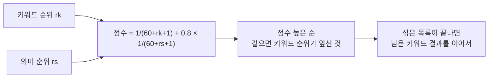

# 10. 검색 (키워드 + 의미 검색)

[← 기능별 아키텍처 목차](../70-feature-architecture.md)

**한 줄 요약**: 글자가 맞는 글(키워드, pg_trgm)과 뜻이 가까운 글(의미 검색, pgvector + bge-m3 임베딩)을 따로 찾은 뒤 순위를 섞어(RRF) 보여 줍니다. 의미 검색이 안 되는 환경에서는 키워드 검색만으로 그대로 동작합니다.

## 구성

## 처리 흐름: 관련도순 검색

## 순위 섞기 (RRF)

## 핵심 규칙

| 항목 | 규칙 |
|---|---|
| 검색어 | 50자, 단어 5개, 한 글자 단어 버림. 두 글자는 제목·태그만, 세 글자 이상은 본문까지(트라이그램 때문) |
| 키워드 | 최근 공개 글 3,000개 안에서 먼저, 모자라면 색인 후보로. 단계 안에서는 최신순 |
| 의미 검색 | bge-m3(로컬) 또는 gemini-embedding-001(768차원). 거리 0.55(로컬)/0.4(Gemini) 이하, 3초 제한. 실패하면 60초 동안 키워드만 |
| 색인 | 60초마다 임베딩 없는/낡은 공개 글 20개, 제목+태그+본문 3,000자 |
| 확장 없을 때 | pg_trgm 없으면 색인 없는 LIKE, pgvector 없으면 키워드만 |
| 사람 검색 | 닉네임·주소, 정확히 같은 것 먼저 20명 |
| 개인정보 | 검색어는 서버 로그에 남기지 않고 길이·시간만. 최근 검색어 8개는 브라우저에만 |

## 코드 위치

- 백엔드: `search/web/SearchController`, `search/application/{SearchQuery, SearchTerms, Snippet}`, `search/semantic/{SemanticSearch, EmbeddingClient, EmbeddingIndexJob, SemanticProperties}`
- 화면: `pages/SearchPage`, `components/SearchBox`, `lib/{search.ts, recentSearches.ts}`
- 테이블: pg_trgm 색인(V2), `post_embedding`(V16, pgvector가 있을 때만)

## 예상 질문

- **왜 키워드 검색만으로는 부족했나요?** "동시성"으로 찾을 때 "race condition"을 다룬 글처럼 글자는 다르지만 뜻이 같은 글을 놓쳤습니다.
- **임베딩 서버가 죽으면?** 60초 동안 의미 검색을 쉬고 키워드 결과만 보여 줍니다. 사용자는 검색 실패를 보지 않습니다.
