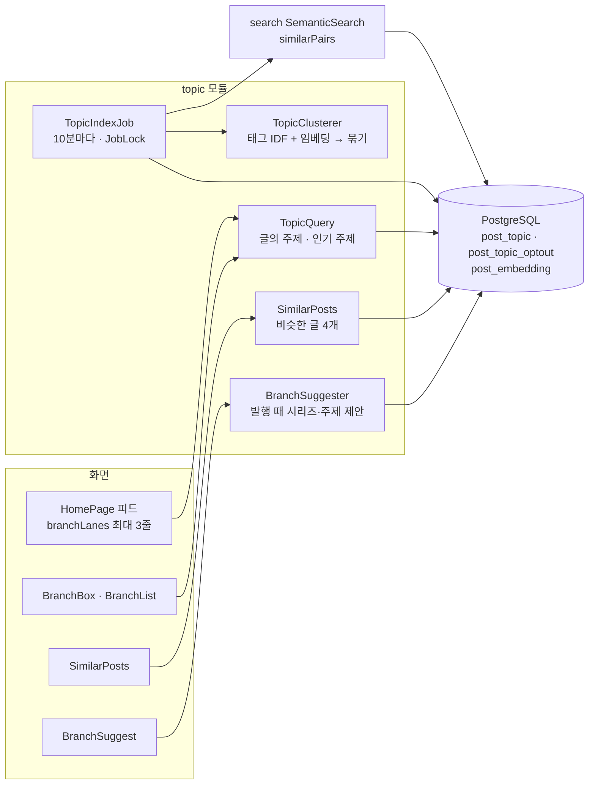
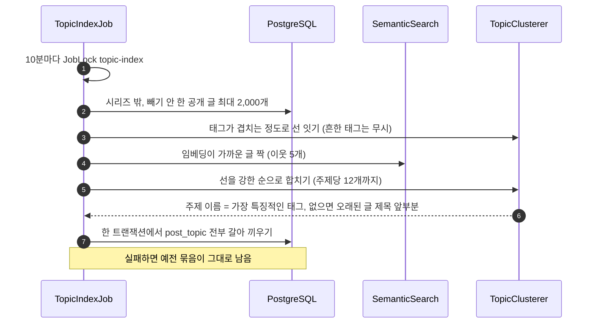

# 11. 주제 가지와 비슷한 글

[← 기능별 아키텍처 목차](../70-feature-architecture.md)

**한 줄 요약**: 시리즈에 넣지 않은 공개 글을 태그와 임베딩으로 10분마다 묶어 "주제"를 만들고, 홈 피드에서 같은 시리즈·주제의 글을 Git 브랜치처럼 선으로 잇습니다. 글 아래에는 비슷한 글 4개를, 발행 때에는 넣을 만한 시리즈·주제를 제안합니다.

## 구성

## 처리 흐름: 주제 묶기

## 핵심 규칙

| 항목 | 규칙 |
|---|---|
| 태그 연결 | IDF 가중 겹침 0.5 이상, 60개 넘는 글에 쓰인 흔한 태그는 제외 |
| 임베딩 연결 | 거리 ≤ 검색 기준 × 0.6, 이웃 5개 |
| 묶음 | Kruskal 방식으로 강한 선부터 합침, 최대 12개. 키 = 가장 작은 글 번호, 방법 TAG·EMBEDDING·MIXED |
| 피드 가지 | 시리즈가 있으면 시리즈, 없으면 주제. 화면은 최대 3줄로 그림. `?branch=s{id}`·`t{key}`로 가지만 보기 |
| 비슷한 글 | 임베딩 이웃에서 같은 시리즈·주제를 빼고, 모자라면 겹치는 태그 수로 채워 4개 |
| 발행 제안 | 내 시리즈·주제 중 점수(겹치는 태그 IDF ÷ 이 글 태그 IDF 합) 0.4 이상 |
| 빼기 | 글쓴이가 주제 묶기에서 뺄 수 있음(`PUT /topic-optout`) |

## 코드 위치

- 백엔드: `topic/{web/TopicController, application/TopicIndexJob, TopicClusterer, TopicQuery, SimilarPosts, BranchSuggester, TopicProperties}`
- 화면: `components/{BranchBox, BranchList, BranchSuggest, SimilarPosts}`, `lib/{branch.ts, branchLanes.ts}`
- 테이블: `post_topic`(V24), `post_topic_optout`(V25)

## 예상 질문

- **AI(LLM)로 주제를 정하나요?** 아니요. 태그 통계와 이미 만든 임베딩만 써서 계산합니다. 추가 비용이 없고 결과가 늘 같습니다.
- **글이 많아지면?** 한 번에 최대 2,000개만 보고, 별도 작업으로 10분마다 돌아 사용자 요청 속도와 무관합니다.
