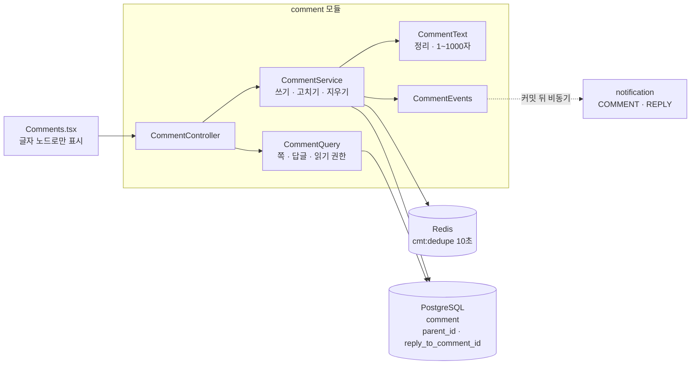
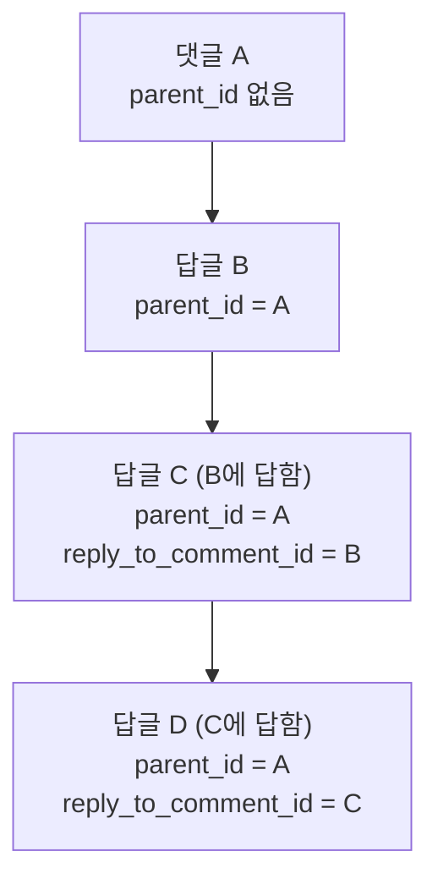
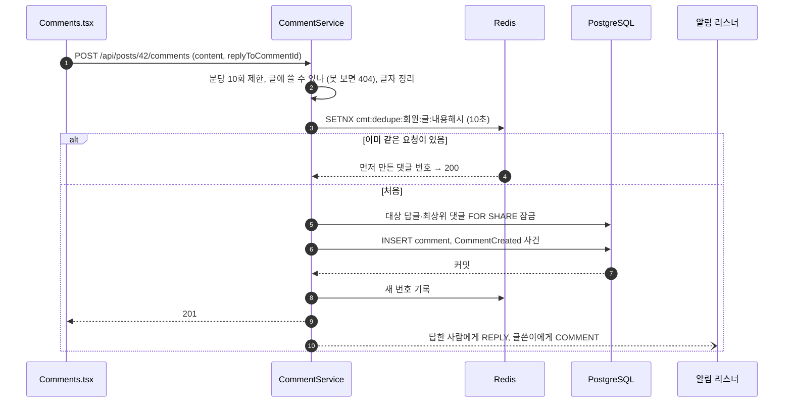

# 12. 댓글·답글

[← 기능별 아키텍처 목차](../70-feature-architecture.md)

**한 줄 요약**: 저장은 깊이 1(댓글 → 답글)로 단순하게 두고, 답글에 단 답글은 "어느 답글에 답했는지"만 따로 적어 화면에서 Git 브랜치처럼 선으로 잇습니다. 댓글은 HTML 없이 글자로만 보여 주고, 같은 댓글이 두 번 올라가지 않게 Redis로 10초 동안 막습니다.

## 구성

## 데이터 모양

저장은 모두 `parent_id = A`(깊이 1)이고, 화면만 `reply_to_comment_id`를 따라 3단계까지 들여 써 선으로 잇습니다(V35).

## 처리 흐름: 답글 쓰기

## 핵심 규칙

| 항목 | 규칙 |
|---|---|
| 글자 | NFC, 보이지 않는 글자 제거(줄바꿈은 둠), 빈 줄 3개 이상은 1개로, 1~1000자. 욕설 필터 없음 |
| 답글 대상 | 같은 글, 지워지거나 숨겨지지 않음, 작성자가 탈퇴하지 않음. 아니면 400 `REPLY_TARGET_UNAVAILABLE` |
| 지우기 | 답글이 있는 최상위 댓글은 "삭제된 댓글" 자리만 남김. 답글은 바로 지우고, 자리만 남은 최상위 댓글에 답글이 다 없어지면 같이 지움 |
| 숨김 | 관리자가 숨긴 댓글은 고칠 수 없음(409 `COMMENT_HIDDEN`) |
| 제한 | 쓰기 분당 10회, 고치기 분당 20회. 한 쪽 20개, 답글 처음 3개 |
| 댓글 수 | 따로 저장하지 않고 `post_stat` 뷰가 셈(지워지거나 숨긴 것 제외) |
| 잠금 순서 | 늘 답글 → 최상위 댓글 순(교착 방지) |
| 링크 | `?comment={id}`로 열면 그 댓글로 이동해 강조 |

## 코드 위치

- 백엔드: `comment/{web/CommentController, application/CommentService, CommentQuery, CommentText, CommentEvents}`
- 화면: `components/Comments`, `lib/comments.ts`
- 테이블: `comment`(V1), `reply_to_comment_id`(V35)

## 예상 질문

- **왜 무한 깊이 트리로 저장하지 않았나요?** 깊이 1이면 한 쪽을 두 번의 단순 쿼리로 읽고, 지우기·댓글 수 규칙도 단순합니다. 대화 흐름은 `reply_to_comment_id` 하나로 화면에서 충분히 보입니다.
- **같은 댓글이 두 번 달리는 건 어떻게 막나요?** 같은 사람·같은 글·같은 내용이면 10초 동안 Redis 키로 하나만 통과시키고, 늦게 온 요청에는 먼저 만든 댓글을 돌려줍니다.
