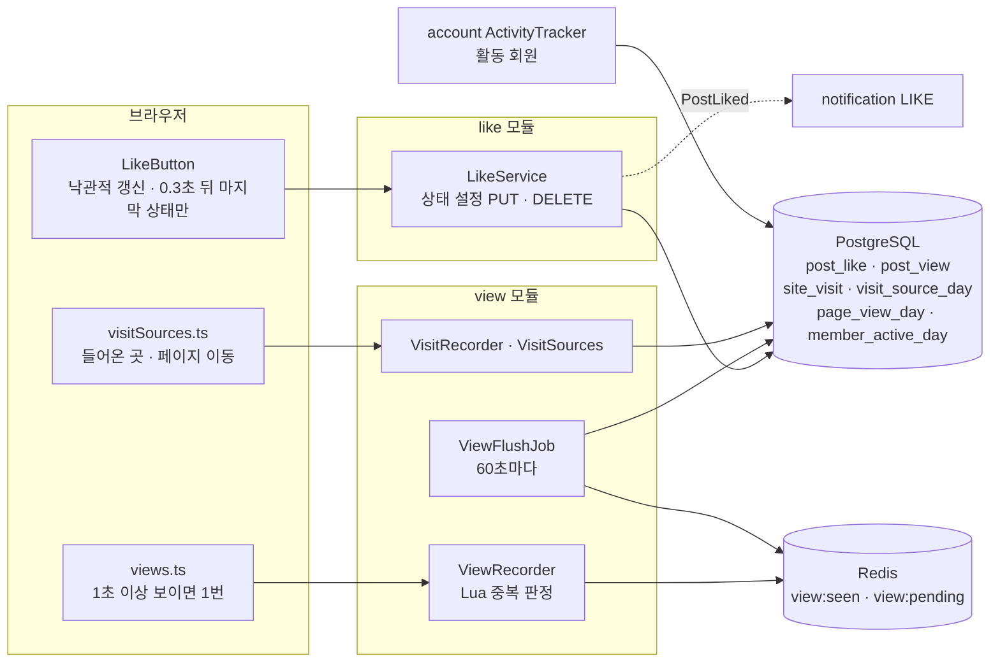
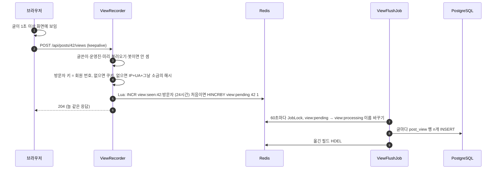

# 13. 좋아요·조회수·방문 통계

[← 기능별 아키텍처 목차](../70-feature-architecture.md)

**한 줄 요약**: 좋아요는 "누름/안 누름" 상태를 정하는 요청이라 몇 번 와도 결과가 같습니다. 조회수는 Redis 스크립트 하나로 중복을 거른 뒤 1분마다 DB로 옮기고, 방문 통계는 원래 IP를 저장하지 않고 해시로만 셉니다.

## 구성

## 처리 흐름: 조회수

## 핵심 규칙

| 항목 | 규칙 |
|---|---|
| 좋아요 | `INSERT … ON CONFLICT DO NOTHING` / `DELETE`. 행이 실제로 바뀐 때만 사건 발행. 내 글은 403, 분당 60회 |
| 좋아요 수 | 저장하지 않고 `post_stat` 뷰가 `count(*)` |
| 좋아한 글 | `/lists/liked`, 누른 순서대로 9개씩 |
| 조회 중복 | 같은 방문자는 24시간에 1번. 동시에 50번 보내도 Lua 하나라 1번 |
| 조회 제외 | 글쓴이, 운영진, 미리 불러오기(`Sec-Purpose` 등), 봇 UA |
| Redis 장애 | 조회는 세지 않고 넘어감 |
| 방문 | 하루·방문자당 한 행, 30분 넘게 쉬면 방문 +1. 들어온 곳(구글·네이버·카카오…·인앱 브라우저)과 페이지별 수를 하루 단위로 |
| 활동 회원 | 로그인 요청이 오면 `last_active_at`은 1시간에 1번, `member_active_day`는 하루 1행 |
| 보관 | 방문·활동 통계 400일(04:40, 04:45 정리) |
| 개인정보 | 원래 IP는 저장하지 않음. `X-Forwarded-For`는 믿는 프록시 대역에서 온 것만 |

## 코드 위치

- 백엔드: `like/*`, `view/{web/ViewController, application/ViewRecorder, ViewFlushJob, VisitRecorder, VisitSources}`, `account/application/ActivityTracker`, `shared/web/ClientIpResolver`
- 화면: `components/LikeButton`, `pages/LikedPage`, `lib/{likes.ts, views.ts, visitSources.ts}`
- 테이블: `post_like`(V1), `post_view`·`post_stat` 뷰(V3), `site_visit`(V20), `member_active_day`(V21), `visit_source_day`·`page_view_day`(V22)

## 예상 질문

- **조회수를 바로 DB에 +1 하면 안 되나요?** 인기 글 한 행에 쓰기가 몰려 잠금 경합이 생깁니다. Redis에 모아 1분마다 한 파드만 옮겨 DB 쓰기를 줄였습니다.
- **좋아요 버튼을 빠르게 여러 번 누르면?** 화면은 바로 바뀌고, 0.3초 동안 멈춘 뒤 마지막 상태 하나만 보냅니다. 서버도 상태 설정이라 순서가 바뀌어도 결과가 같습니다.
