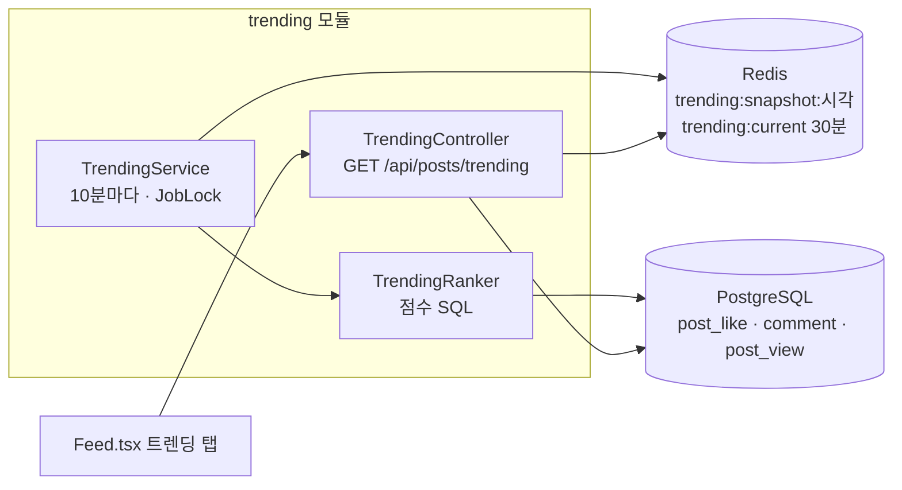
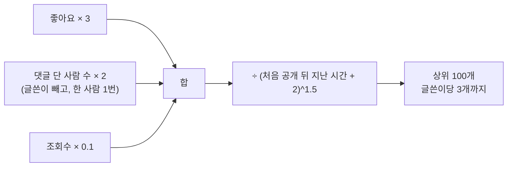
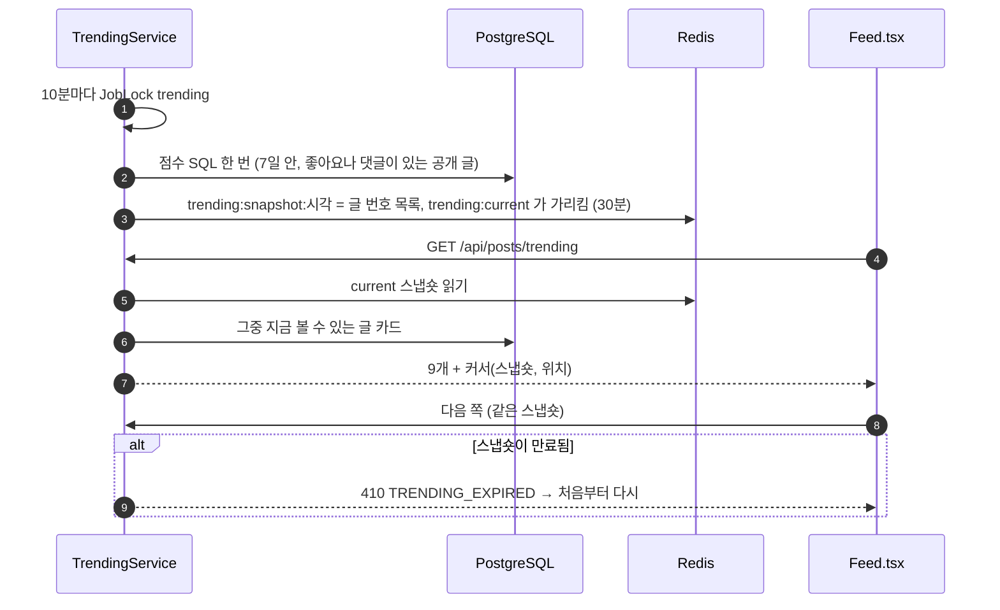

# 14. 트렌딩

[← 기능별 아키텍처 목차](../70-feature-architecture.md)

**한 줄 요약**: 10분마다 최근 7일 공개 글의 점수를 SQL 한 번으로 계산해 상위 100개를 Redis 스냅숏으로 저장하고, 화면은 그 스냅숏을 커서로 넘겨 봅니다. 스냅숏 덕분에 순위가 바뀌어도 다음 쪽에서 글이 겹치거나 빠지지 않습니다.

## 구성

## 점수

## 처리 흐름

## 핵심 규칙

| 항목 | 규칙 |
|---|---|
| 후보 | 공개 목록 조건, 처음 공개 7일 안, 좋아요나 댓글이 1개 이상 |
| 동점 | 처음 공개 최신순, 그다음 번호 큰 순 |
| 캐시 | `Cache-Control: public, max-age=60` |
| Redis 장애 | 첫 쪽만 바로 계산해 `temporary=true`로 주고, 다음 쪽 없음 |
| 볼 수 없는 글 | 스냅숏 뒤에 숨겨지거나 지워진 글은 쪽을 채울 때 건너뜀 |

## 코드 위치

- 백엔드: `trending/{web/TrendingController, application/TrendingService, TrendingRanker}`
- 화면: `components/Feed`, `lib/trending.ts`

## 예상 질문

- **왜 시간으로 나누나요?** 오래된 인기 글이 계속 위에 있지 않게, 새 글이 반응을 받으면 빨리 오르도록 하는 감쇠입니다(Hacker News 방식).
- **글쓴이당 3개 제한은?** 한 사람의 글이 순위를 독차지하지 않게 하려는 것입니다.
