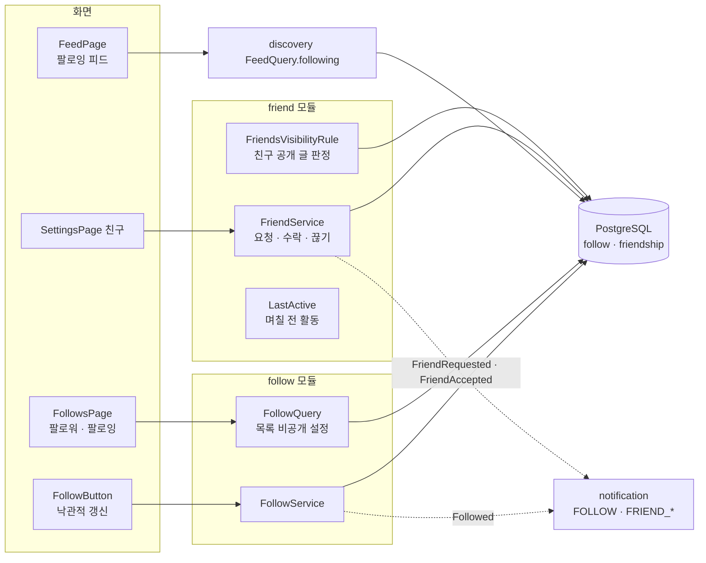
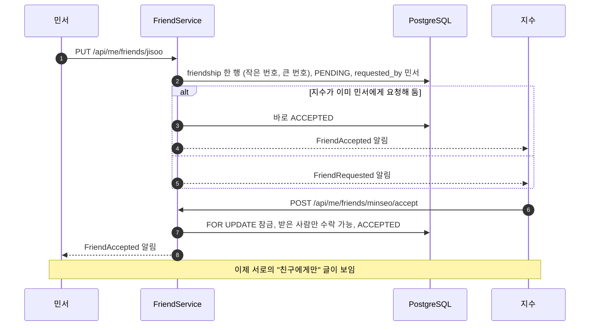

# 15. 팔로우·피드·친구

[← 기능별 아키텍처 목차](../70-feature-architecture.md)

**한 줄 요약**: 팔로우는 한쪽 방향(새 글을 피드로 받기), 친구는 양쪽이 수락하는 관계(친구 공개 글 보기)입니다. 둘 다 "상태 설정" 요청이라 여러 번 와도 결과가 같고, 바뀐 때만 알림 사건을 냅니다.

## 구성

## 처리 흐름: 친구 요청과 수락

## 핵심 규칙

| 항목 | 규칙 |
|---|---|
| 팔로우 | `follow(follower_id, followee_id)`, 나 자신은 400 `FOLLOW_SELF`. 응답에 팔로워 수 |
| 피드 | 팔로우한 사람의 글, 홈과 같은 카드·정렬. 첫 쪽에 "팔로우한 사람이 있나" 표시 |
| 목록 비공개 | `member.follow_list_public`(V29). 끄면 본인·운영진만 목록을 보고, 수는 계속 보임 |
| 친구 행 | 한 쌍에 한 행(`member_a_id < member_b_id`), PENDING → ACCEPTED |
| 친구 끊기 | 거절·요청 취소·친구 끊기 모두 행 삭제, 알림 없음 |
| 제한 | 친구 요청 하루 100회 |
| 마지막 활동 | 정확한 시각 대신 0~7일 전(7 = 일주일 이상)만 보여 줌 |
| 탈퇴 | 탈퇴 신청 즉시 친구 관계 삭제(V33), 복구해도 되살리지 않음 |

## 코드 위치

- 백엔드: `follow/{web/FollowController, application/FollowService, FollowQuery, FollowSql}`, `friend/{web/FriendController, application/FriendService, FriendsVisibilityRule, LastActive, FriendshipWithdrawalListener}`, `discovery/application/FeedQuery`
- 화면: `components/FollowButton`, `pages/{FeedPage, FollowsPage, SettingsPage}`, `lib/{follow.ts, friends.ts}`
- 테이블: `follow`, `friendship`(V1), `member.follow_list_public`(V29)

## 예상 질문

- **팔로우와 친구를 왜 나눴나요?** 팔로우는 공개 구독이라 상대 허락이 필요 없고, 친구는 비공개에 가까운 글을 보여 주는 권한이라 양쪽 동의가 필요합니다.
- **친구 공개 판정은 어디서 하나요?** `VisibilityRule`을 구현한 `FriendsVisibilityRule`이 글 접근 정책에 끼어들어 판정합니다(04 참고).
