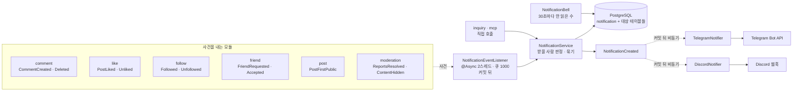
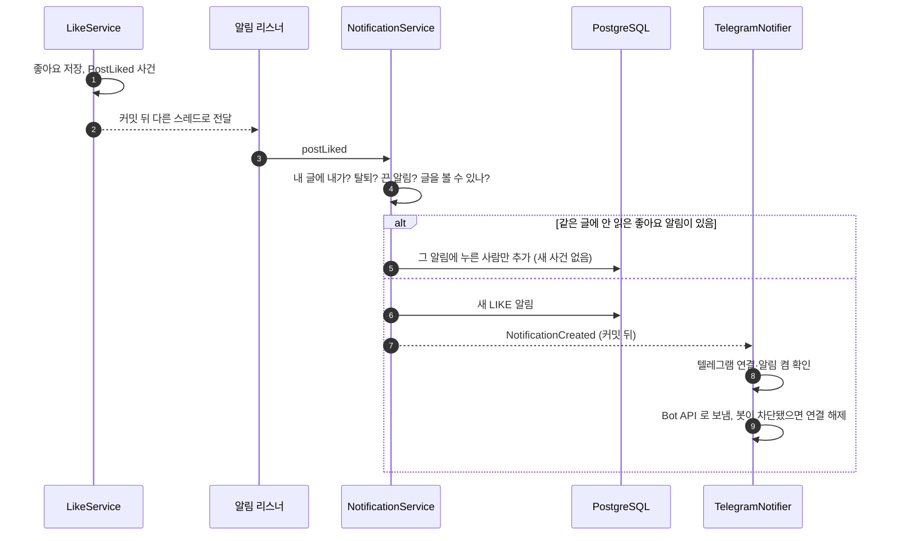
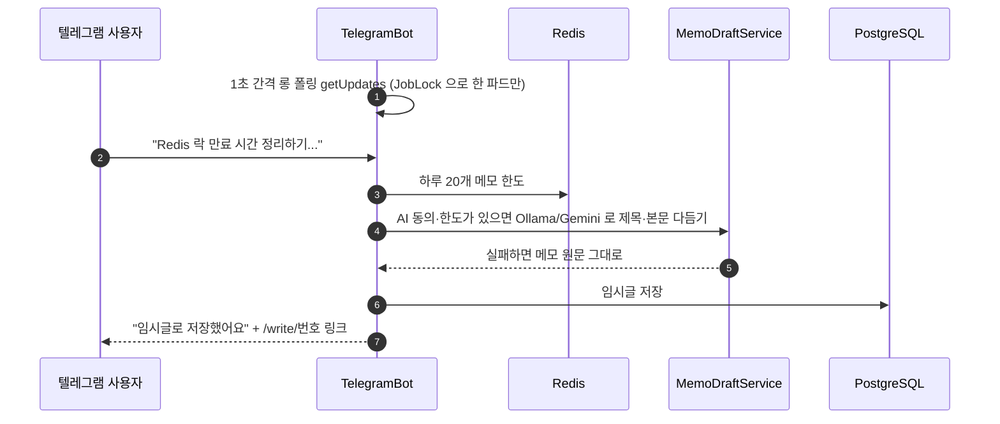

# 16. 알림 (앱·텔레그램·디스코드)

[← 기능별 아키텍처 목차](../70-feature-architecture.md)

**한 줄 요약**: 각 모듈이 낸 도메인 사건을 알림 리스너가 커밋 뒤 비동기로 받아 앱 알림을 만들고, 새 알림이 생기면 다시 사건(`NotificationCreated`)을 내어 텔레그램·디스코드로 퍼뜨립니다. 텔레그램 봇은 메모를 받아 임시글로 바꾸기도 합니다.

## 구성: 사건이 알림이 되기까지

## 처리 흐름: 좋아요 알림이 텔레그램까지

## 처리 흐름: 텔레그램 메모 → 임시글

## 핵심 규칙

| 항목 | 규칙 |
|---|---|
| 종류 | 11가지. 사용자가 끌 수 있는 것: 댓글·답글·좋아요·팔로우·새 글·AI 글감 제안·친구 요청·친구 수락. 운영 알림(신고 처리·숨김·문의 답변)은 못 끔 |
| 묶기 | 좋아요·팔로우는 안 읽은 같은 알림에 사람만 추가. 팔로우·친구는 같은 사람에게 7일에 1번, 좋아요는 글마다 1번 |
| 새 글 알림 | 팔로워 ∪ 시리즈 구독자, 중복 없이 |
| 비동기 | 알림 2스레드·큐 1000, 넘치면 버리고 경고. 텔레그램·디스코드 각 2스레드·큐 500 |
| 보관 | 90일 지난 알림 삭제, 받는 사람당 최신 1,000개(매일 04:30) |
| 종 아이콘 | 30초마다 안 읽은 수, 탭이 가려지면 멈춤, `99+` |
| 텔레그램 연결 | 설정에서 코드 발급(10분, Redis) → 봇에 `/start 코드` → `member_telegram` 저장 |
| 디스코드 | 웹훅 주소를 받아 확인 후 저장(V27). 호스트는 늘 `discord.com`만 부르고 토큰은 화면에 돌려주지 않음. 연결·테스트 시간당 10회 |

## 코드 위치

- 백엔드: `notification/{application/NotificationEventListener, NotificationService, NotificationAsyncConfig, NotificationCleanupJob, NotificationType}`, `telegram/{application/TelegramBot, TelegramNotifier, TelegramLinks, infra/HttpTelegramApi}`, `discord/*`, `ai/application/MemoDraftService`
- 화면: `components/{NotificationBell, NotificationEntry}`, `pages/NotificationsPage`, `lib/{notifications.ts, telegram.ts, discord.ts}`
- 테이블: `notification`, `notification_actor`·`notification_post`·`notification_comment` 등 대상 테이블, `notification_mute`, `member_telegram`(V7), `member_discord`(V27)

## 예상 질문

- **알림 만들기가 실패하면 좋아요도 실패하나요?** 아니요. 커밋이 끝난 뒤 다른 스레드에서 만들기 때문에 본래 요청과 분리돼 있습니다. 대신 서버가 그 순간 죽으면 알림 하나를 잃을 수 있고, 이는 받아들인 절충입니다.
- **텔레그램은 왜 웹훅이 아니라 폴링인가요?** 롱 폴링은 서버에서 바깥으로 나가는 연결만 쓰므로, 텔레그램이 부를 공개 웹훅 주소 없이도 동작합니다(코드 기준 추정 이유). 여러 파드 중 한 곳만 받도록 `JobLock`을 잡고, 어디까지 읽었는지는 Redis `tg:offset`에 둡니다.
