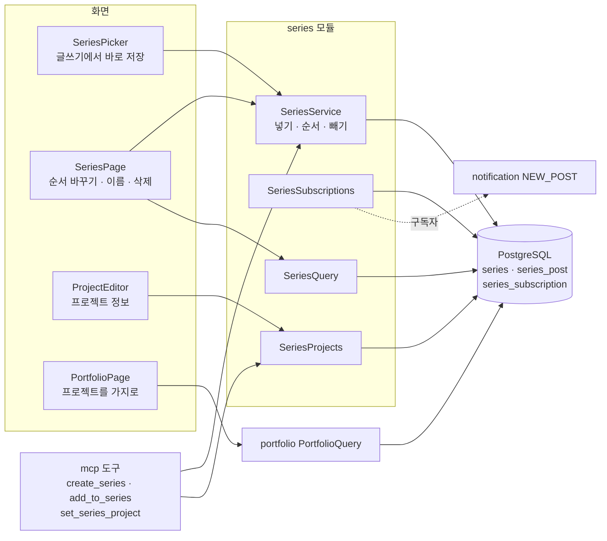
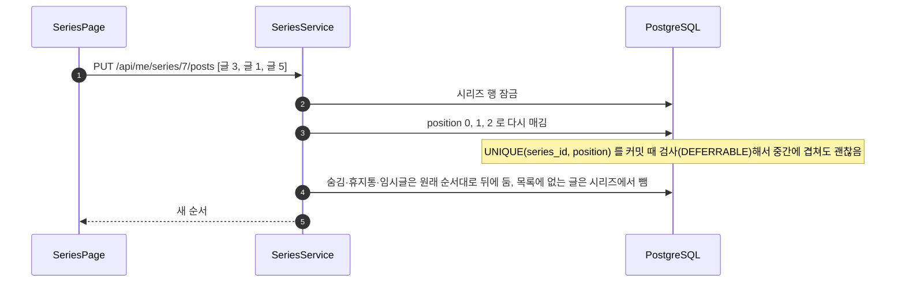

# 17. 시리즈와 포트폴리오

[← 기능별 아키텍처 목차](../70-feature-architecture.md)

**한 줄 요약**: 글을 순서 있는 시리즈로 묶고, 시리즈를 구독하면 새 글 알림을 받습니다. 시리즈에 기간·기술·팀이 한 일·내 역할을 적으면 `/@handle/portfolio`에 프로젝트로 보입니다.

## 구성

## 처리 흐름: 순서 바꾸기

## 핵심 규칙

| 항목 | 규칙 |
|---|---|
| 한 글 한 시리즈 | `series_post.post_id`가 PK |
| 크기 | 회원당 시리즈 100개, 시리즈당 글 200개(`SERIES_FULL`). 이름 50자 |
| 넣기 | 맨 뒤(`max(position)+1`). 잠금 순서는 글 → 시리즈 |
| 구독 | 내 시리즈는 구독 불가. 새 글 알림은 팔로워와 합쳐 중복 없이 |
| 프로젝트 정보 | 기간 40자, 한 줄 설명 200자, 기술 12개(각 30자), 팀이 한 일·내 역할 각 2,000자 (V26) |
| 포트폴리오 | 공개 자료만 써서 누가 봐도 같은 화면. 프로필·소셜 링크·받은 좋아요 수 + 프로젝트(최근 고친 순) |
| 읽기 진도 | 읽은 글을 브라우저에 기억해 시리즈 진도를 보여 줌 |

## 코드 위치

- 백엔드: `series/{web/SeriesController, application/SeriesService, SeriesSubscriptions, SeriesProjects, SeriesQuery}`, `portfolio/*`
- 화면: `pages/{SeriesPage, PortfolioPage}`, `components/{SeriesPicker, ProjectEditor}`, `lib/{series.ts, portfolio.ts}`
- 테이블: `series`·`series_post`(V8), `series_subscription`(V25), 프로젝트 컬럼(V26)

## 예상 질문

- **순서를 바꿀 때 UNIQUE 제약에 걸리지 않나요?** 제약을 `DEFERRABLE INITIALLY DEFERRED`로 두어 트랜잭션 끝에서만 검사합니다.
- **AI가 포트폴리오를 써 줄 수 있나요?** MCP 도구 `set_series_project`로 적을 수 있고, AI 발행을 허용한 사용자만 쓸 수 있습니다(18 참고).
