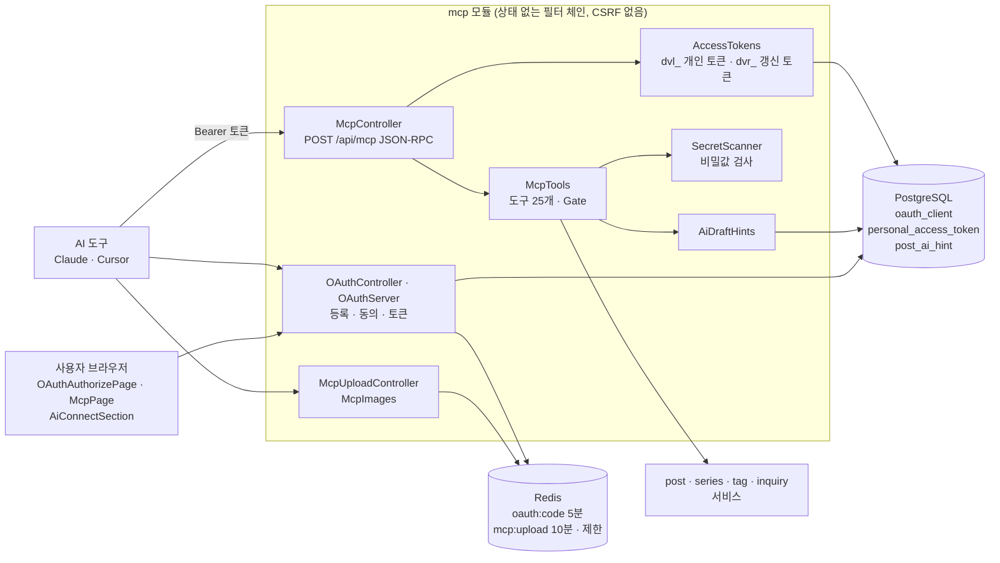
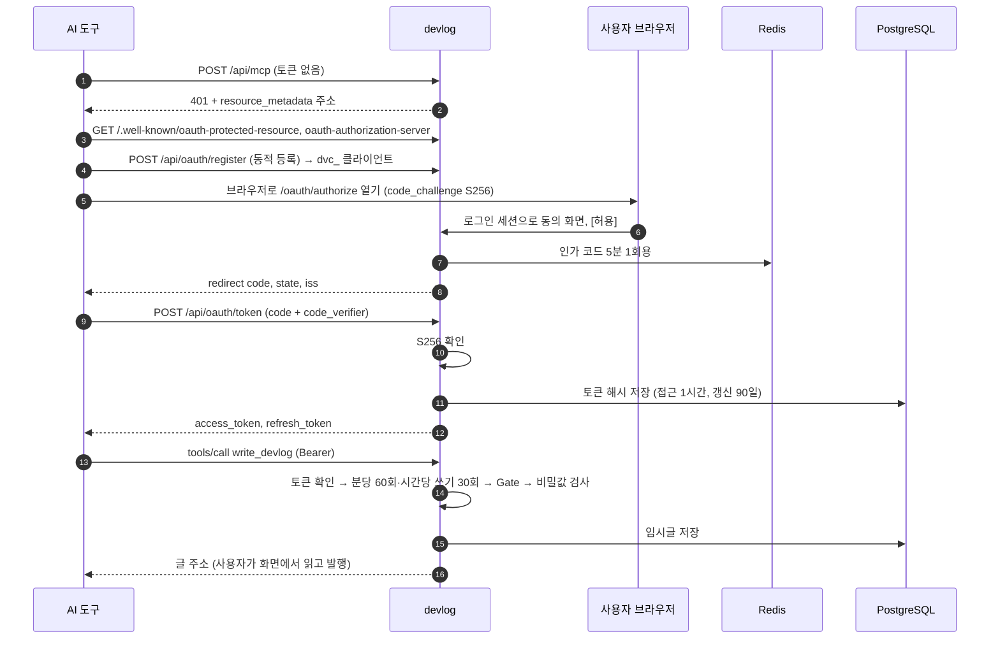
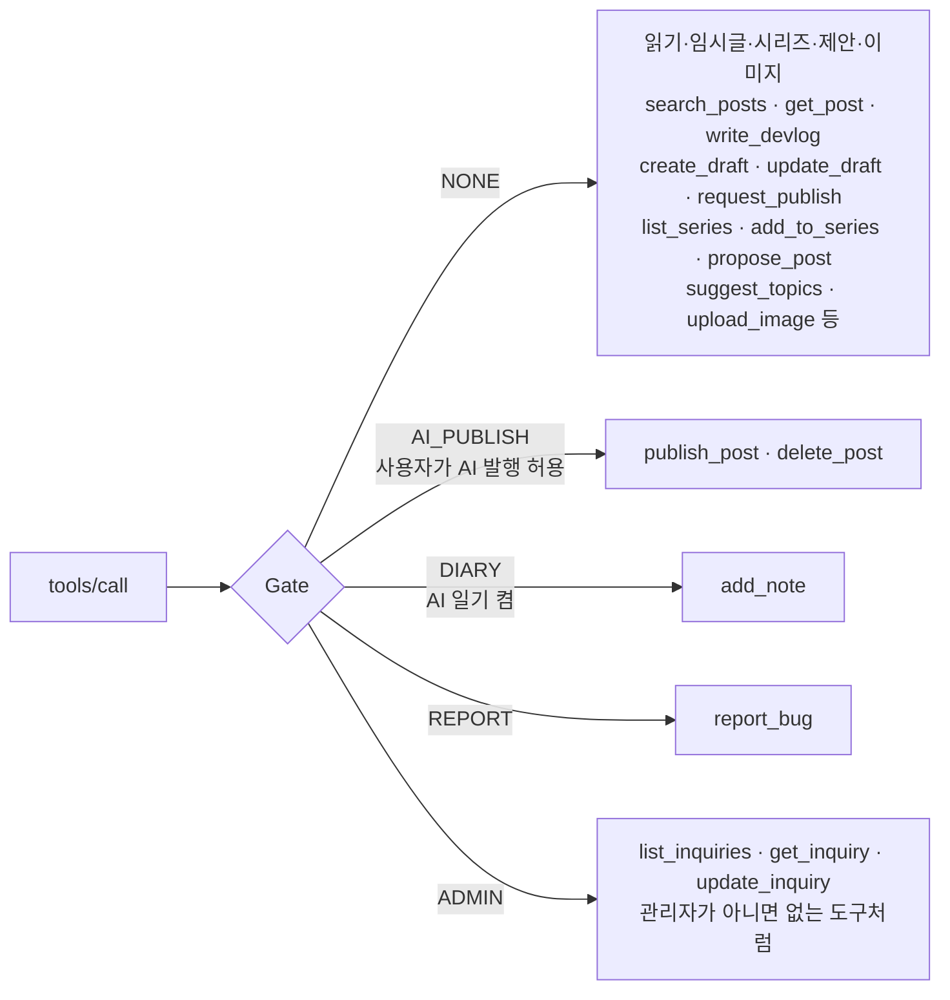

# 18. MCP 서버와 AI 연결

[← 기능별 아키텍처 목차](../70-feature-architecture.md)

**한 줄 요약**: devlog는 MCP 서버(`/api/mcp`)를 내장해서, Claude·Cursor 같은 AI 도구가 사용자 대신 개발 일지 임시글을 쓰고 글·시리즈를 다룰 수 있습니다. AI 도구는 OAuth 2.1(PKCE) 또는 개인 토큰으로 로그인하고, 쓰기 도구는 권한 문(Gate)과 비밀값 검사를 거칩니다.

## 구성

## 처리 흐름: 처음 연결 (OAuth 2.1 + PKCE) 과 도구 호출

## 도구와 권한 문(Gate)

## 핵심 규칙

| 항목 | 규칙 |
|---|---|
| 프로토콜 | 상태 없는 Streamable HTTP. 요청 하나에 JSON 응답 하나, 세션·SSE 없음. 2025-11-25·2025-06-18·2025-03-26 |
| 인증 | 개인 토큰 `dvl_`(회원당 10개, 30·90·365일) 또는 OAuth. 저장은 해시만 |
| OAuth | 공개 클라이언트만, PKCE S256 필수, redirect는 https 또는 localhost. 범위 `devlog.read`·`devlog.write` |
| 쓰기 조건 | WRITE 범위 + 이메일 인증. Gate는 목록에서만이 아니라 호출 때 다시 확인 |
| 제한 | 분당 60회, 쓰기 시간당 30회. 메모는 하루 60개로 따로 |
| 비밀값 검사 | 토큰·API 키·AWS 키·개인 키·JWT·주민번호·URL 속 비밀번호. 찾으면 종류만 알림. 발행·메모는 막고, 임시글은 경고만 |
| 사진 | 작은 것은 바로(2MB), 큰 것은 1회용 업로드 주소(10분, 10MB) |
| 안내문 | `initialize`의 instructions가 사용자 설정(AI 발행·일기·관리자)에 따라 달라짐 |

## 코드 위치

- 백엔드: `mcp/web/{McpController, OAuthController, AccessTokenController, McpUploadController}`, `mcp/application/{McpTools, AccessTokens, OAuthServer, SecretScanner, AiDraftHints, McpImages}`, `config/SecurityConfig`(`mcpFilterChain`)
- 화면: `pages/{McpPage, OAuthAuthorizePage}`, `components/{AiConnectSection, AiConnectGuide}`, `lib/mcp.ts`
- 테이블: `oauth_client`·`personal_access_token`·`post_ai_hint`(V13), `member.ai_publish_allowed`(V14)

## 예상 질문

- **AI가 내 글을 마음대로 발행하나요?** 기본은 임시글까지만 씁니다. 사용자가 설정에서 AI 발행을 켠 경우에만 발행·삭제 도구가 열립니다.
- **AI가 코드 속 API 키를 글에 넣으면?** `SecretScanner`가 발행과 메모를 막고, 임시글에는 경고를 붙입니다. 값은 응답에도 다시 보여 주지 않습니다.
