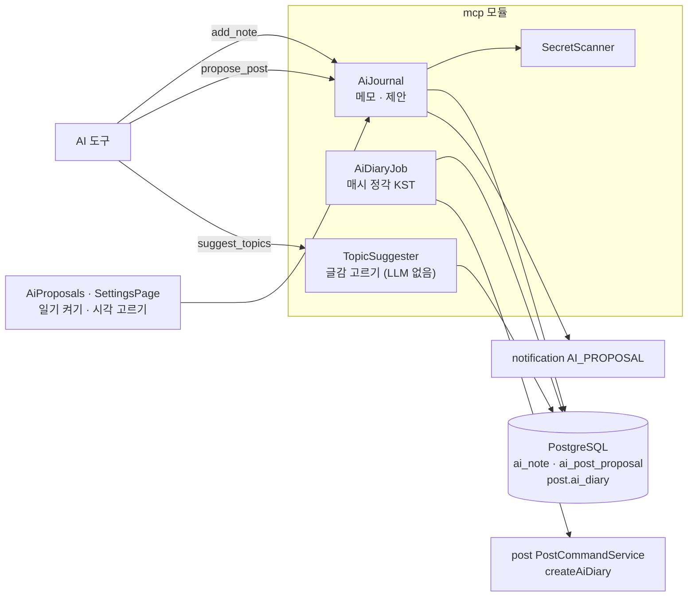
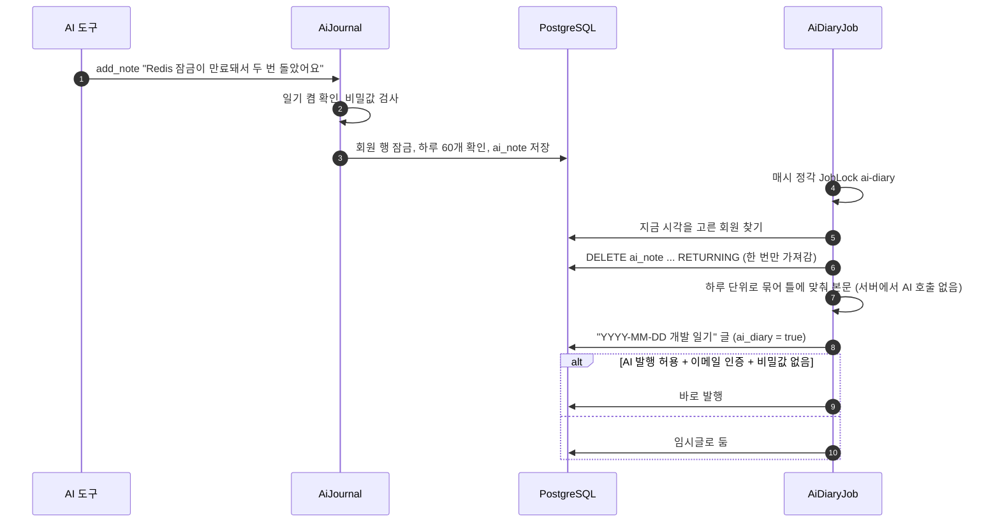
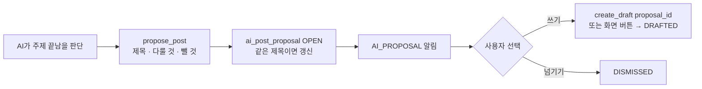

# 19. AI 일기·글감 제안

[← 기능별 아키텍처 목차](../70-feature-architecture.md)

**한 줄 요약**: AI 도구가 작업 중에 남긴 한두 문장 메모(`add_note`)를 모았다가, 사용자가 고른 시각에 하루치를 묶어 "개발 일기" 글로 만듭니다. 주제가 끝나면 AI가 글감을 제안(`propose_post`)하고, 사용자는 화면에서 임시글로 만들거나 넘깁니다.

## 구성

## 처리 흐름: 메모 → 일기

## 처리 흐름: 글감 제안 → 임시글

## 핵심 규칙

| 항목 | 규칙 |
|---|---|
| 메모 | 하루 60개, 1,000자, 주제당 50개. 7일 지난 메모 삭제. 일기를 끄면 메모도 지움 |
| 일기 시각 | 회원이 0~23시 중 고름(기본 0시, V23). 그 시각에 끝나는 24시간을 하루로 묶음 |
| 중복 방지 | `DELETE … RETURNING`으로 메모를 꺼내서 작업이 두 번 돌아도 일기 하나 |
| 검색 노출 | 일기 글은 독자에게 보이지만 noindex·광고 없음·사이트맵 제외(08 참고) |
| 제안 | 회원당 열린 제안 20개, 같은 제목은 갱신. OPEN → DRAFTED / DISMISSED |
| 글감 고르기 | 메모·일기·제안·임시글에서 동시성·장애·보안·성능·접근성·운영·인프라·AI·설계 렌즈로 분류. 이미 발행한 글과 겹치는 정도 계산. 기본 14일·5개. IP·이메일·비밀값은 가림 |

## 코드 위치

- 백엔드: `mcp/application/{AiJournal, AiDiaryJob, TopicSuggester}`, `mcp/web/AiJournalController`
- 화면: `components/{AiProposals, AiConnectSection}`, `pages/{SettingsPage, McpPage}`
- 테이블: `ai_note`·`ai_post_proposal`·`member.ai_diary_enabled`(V18), `ai_diary_hour`·`notification_ai_proposal`(V23), `post.ai_diary`(V32)

## 예상 질문

- **일기는 AI가 서버에서 쓰나요?** 아니요. 메모 자체가 AI가 1인칭으로 쓴 문장이라, 서버는 틀에 맞춰 묶기만 합니다. 서버 AI 비용이 들지 않습니다.
- **글감 추천도 LLM인가요?** 아니요. 키워드 렌즈와 겹침 계산으로 고르는 결정적 규칙이라 같은 입력이면 같은 결과입니다.
