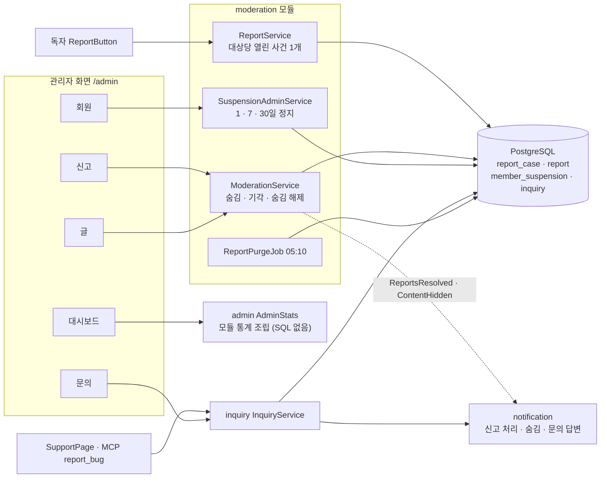
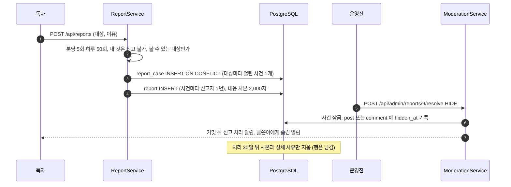

# 20. 신고·관리자·문의

[← 기능별 아키텍처 목차](../70-feature-architecture.md)

**한 줄 요약**: 독자가 글·댓글을 신고하면 대상마다 사건 하나로 모이고, 운영진이 숨김 또는 기각으로 처리합니다(자동 숨김 없음). 관리자 화면은 각 모듈의 통계를 모아 대시보드를 그리고, 문의·버그 신고는 웹과 MCP 양쪽에서 받습니다.

## 구성

## 처리 흐름: 신고 → 숨김

## 핵심 규칙

| 항목 | 규칙 |
|---|---|
| 신고 이유 | 스팸·욕설·음란·개인정보·저작권·기타(기타만 200자 설명 필수) |
| 자동 숨김 | 없음. 숨김은 늘 사람이 결정 |
| 자기 사건 | 운영진은 자기 콘텐츠 신고를 처리할 수 없음 |
| 숨김 해제 | 글쓴이에게 알리지 않음. 관리자가 신고 없이 바로 숨길 수도 있음 |
| 정지 | 1·7·30일, 사유 200자, 한 번에 하나. 정지하면 모든 세션 종료. 기한이 지나면 다음 로그인 때 풀림 |
| 역할 | USER · MANAGER · ADMIN(V19). 역할 부여는 ADMIN만. `/api/admin/**`는 운영진이 아니면 404 |
| 대시보드 | 7·30·90일. 회원·글·댓글·좋아요·조회·대기 신고·열린 문의, 직전 기간 대비, 활동 회원, 방문자, 인기 글·작성자, 들어온 곳, 인기 페이지 |
| 문의 | 질문·버그·제안·신고. 받음 → 처리 중 → 해결/닫힘. 시간당 10회·하루 30회. 고친 버전은 `x.y.z`. 답하면 알림 |

## 코드 위치

- 백엔드: `moderation/{web/ReportController, AdminController, application/ReportService, ModerationService, SuspensionAdminService, ReportPurgeJob}`, `admin/{web/AdminConsoleController, application/AdminStats}`, `inquiry/*`, `account/application/{RoleService, SuspensionService}`
- 화면: `pages/Admin*Page`, `components/{AdminNav, ReportButton, BarChart}`, `pages/SupportPage`, `lib/{admin.ts, moderation.ts, inquiry.ts}`
- 테이블: `report_case`·`report`·`member_suspension`(V1), `notification_report`(V3), `inquiry`·`notification_inquiry`(V15)

## 예상 질문

- **신고가 많이 쌓이면 자동으로 숨기지 않나요?** 신고를 몰아서 남의 글을 내리는 악용을 막으려고 자동 숨김을 두지 않았습니다(spec 019 FR-016).
- **관리자 통계는 SQL을 직접 쓰나요?** `AdminStats`는 SQL이 없고 각 모듈의 `*Stats` 클래스 결과를 조립만 합니다. 모듈 테이블 구조가 바뀌어도 관리자 코드는 그대로입니다.
