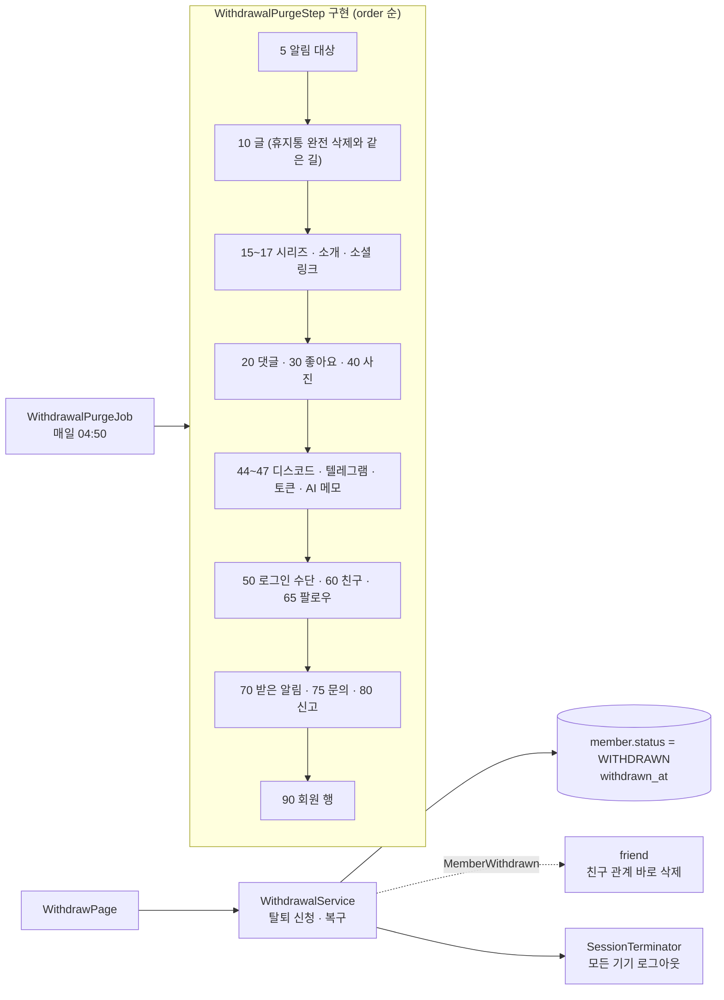
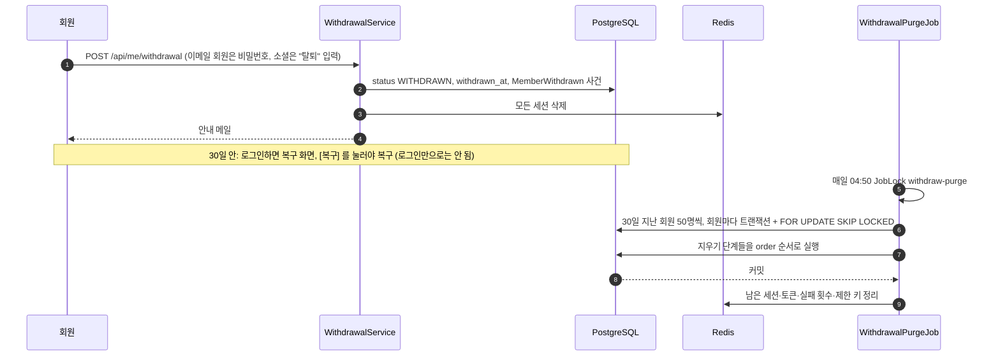

# 21. 회원 탈퇴·복구

[← 기능별 아키텍처 목차](../70-feature-architecture.md)

**한 줄 요약**: 탈퇴를 신청하면 바로 로그아웃되고 글이 모두 감춰지며, 30일 안에는 복구할 수 있습니다. 30일이 지나면 새벽 작업이 모듈마다 등록한 "지우기 단계"를 정해진 순서로 실행해 개인 데이터를 지웁니다.

## 구성: 모듈마다 지우기 단계를 끼워 넣기

## 처리 흐름

## 핵심 규칙

| 항목 | 규칙 |
|---|---|
| 유예 | 30일. 그동안 글·댓글·블로그가 모두 감춰짐(`withdrawn_at IS NULL` 조건) |
| 확인 | 비밀번호 5번 틀리면 잠금. 관리자는 탈퇴 불가 |
| 친구 관계 | 신청 즉시 삭제, 복구해도 되살리지 않음(V33) |
| 복구 | 명시적으로 `POST /api/me/restore` |
| 단계 순서 | 다른 행을 참조하는 것부터 지우고 회원 행은 맨 마지막(90) |
| 즉시 삭제 | 관리자가 `POST /api/admin/members/{handle}/purge`로 바로 실행 가능 |

## 코드 위치

- 백엔드: `account/application/{WithdrawalService, WithdrawalPurgeJob, WithdrawalPurgeStep}`, 각 모듈의 `*WithdrawalPurgeStep`, `friend/application/FriendshipWithdrawalListener`, `shared/security/SessionTerminator`
- 화면: `pages/{WithdrawPage, WithdrawnPage, RestorePage}`, `lib/{withdraw.ts, restore.ts}`, `App.tsx`의 `WithdrawnGate`

## 예상 질문

- **account 모듈이 모든 테이블을 알아야 하지 않나요?** 아니요. 각 모듈이 자기 데이터 지우는 법을 `WithdrawalPurgeStep`으로 등록하고, account는 순서대로 부르기만 합니다. 새 모듈을 만들면 단계 하나만 추가하면 됩니다.
- **중간에 실패하면?** 회원 한 명이 한 트랜잭션이라 통째로 취소되고 다음 날 다시 시도합니다.
