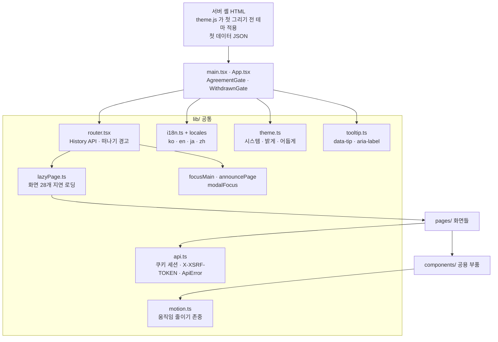
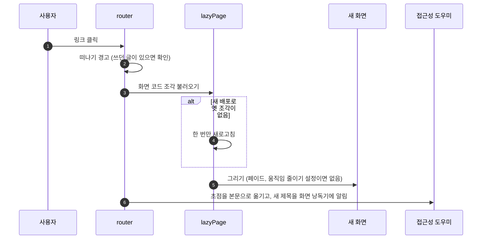

# 22. 화면 공통 (라우터·다국어·다크 모드·접근성)

[← 기능별 아키텍처 목차](../70-feature-architecture.md)

**한 줄 요약**: React 19 SPA는 직접 만든 작은 라우터와 화면별 코드 나누기로 첫 로딩을 가볍게 하고, API 호출·다국어·테마·툴팁·접근성을 `lib/` 공통 모듈로 모았습니다. 서버가 넣어 준 첫 데이터가 있으면 API를 다시 부르지 않고 바로 그립니다.

## 구성

## 처리 흐름: 화면 이동 한 번

## 핵심 규칙

| 항목 | 규칙 |
|---|---|
| 라우터 | react-router 대신 작은 자체 라우터. 이동 때 초점 이동·제목 알림 |
| 코드 나누기 | 화면별 지연 로딩, 마크다운 강조·mermaid·사전도 쓸 때만 불러옴 |
| API | 같은 출처 쿠키 세션. CSRF 쿠키가 없으면 `/api/auth/me`로 먼저 받음. 네트워크 실패는 `ApiError(0, 'NETWORK')` |
| 다국어 | 한국어 문장을 키로 쓰는 사전, 고른 언어만 불러옴. `?lang=` → 저장한 값 → 브라우저 언어 → 한국어. 관리자 화면은 한국어만 |
| 다크 모드 | 이 기기에만 저장(`blog.theme`). 첫 그리기 전에 적용해 깜빡임 없음 |
| 움직임 | 첫 스크롤·입력 뒤에만 등장 효과. `prefers-reduced-motion`이면 모두 끔 |
| 툴팁 | 아이콘·버튼마다 마우스를 올리면 기능 설명(350ms 지연) |
| 접근성 | 본문으로 건너뛰기, 이동 뒤 제목 알림, 대화상자 초점 가두기, WCAG AA 명도 대비 |

## 코드 위치

- `app/frontend/src/{main.tsx, App.tsx, styles.css}`
- `lib/{router.tsx, lazyPage.ts, api.ts, i18n.ts, locales/, theme.ts, motion.ts, tooltip.ts, focusMain.ts, announcePage.ts, modalFocus.ts}`
- `components/{Header, MobileNav, Modal, PageAnnouncer, PageErrorBoundary, LanguageMenu, TooltipLayer}`

## 예상 질문

- **번역이 빠지면 어떻게 알 수 있나요?** `i18n.test.ts`가 사전에 빠진 키와 자리표시(`{n}` 등) 불일치를 테스트에서 잡습니다.
- **배포 직후 화면이 깨지지 않나요?** 옛 화면이 새 서버에 없는 코드 조각을 찾으면 한 번만 새로고침해 새 버전을 받습니다.
