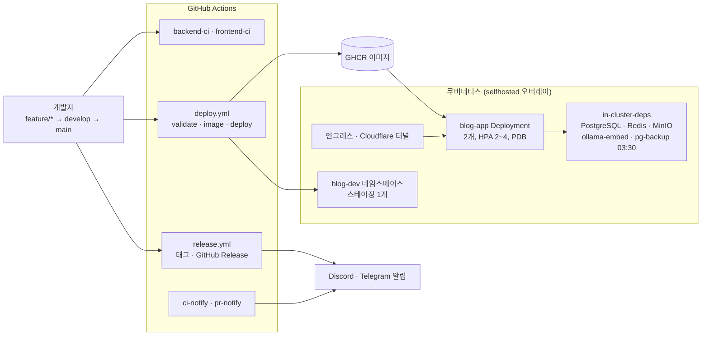
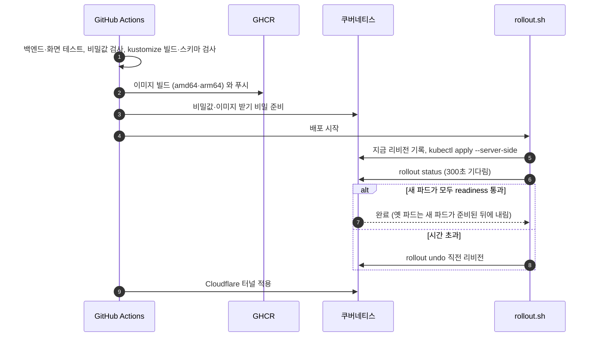
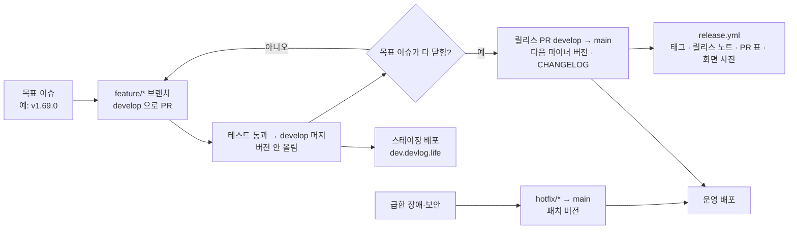

# 23. 배포·운영

[← 기능별 아키텍처 목차](../70-feature-architecture.md)

**한 줄 요약**: `main`에 합쳐지면 GitHub Actions가 테스트 → 이미지(amd64·arm64) → GHCR → kustomize로 쿠버네티스 배포까지 하고, 새 파드가 준비되지 않으면 직전 버전으로 자동 롤백합니다. `develop`은 스테이징(`dev.devlog.life`)에, CHANGELOG가 바뀌면 릴리스 노트가 자동으로 나갑니다.

## 구성

## 처리 흐름: main 배포와 자동 롤백

## 처리 흐름: 목표 단위 Git Flow 릴리스

## 핵심 규칙

| 항목 | 규칙 |
|---|---|
| 이미지 | 3단계 빌드(node 22 → JDK 21 → JRE 21), 레이어드 jar, 사용자 10001, 포트 8080 |
| 헬스 체크 | liveness `/actuator/health/liveness`, readiness `/actuator/health/readiness` |
| 무중단 | `maxUnavailable: 0`, PodDisruptionBudget |
| 오버레이 | `selfhosted`(운영 기준), `nhn`(학교 공용, 보류), `local`, `staging`(`blog-dev`) |
| 네트워크 정책 | DB·Redis는 앱에서만, MinIO는 앱과 인그레스에서만 |
| 비밀값 | 저장소에 넣지 않음. 쿠버네티스 Secret·GitHub Secret, `check-no-secrets.sh`가 CI에서 검사 |
| DB 변경 | Flyway V1~V35, 앱이 뜰 때 적용 |
| 백업 | `pg-backup` CronJob 매일 03:30 |
| 릴리스 노트 | CHANGELOG를 jar에 넣어 `/releases` 화면과 `GET /api/release-notes`로도 보여 줌 |

## 코드 위치

- `deploy/docker/Dockerfile`, `deploy/k8s/{base, overlays, components/in-cluster-deps, addons}`, `deploy/scripts/{rollout.sh, check-no-secrets.sh}`
- `.github/workflows/{backend-ci, frontend-ci, deploy, release, ci-notify, pr-notify}.yml`
- `CONTRIBUTING.md`, `.github/RELEASE_TEMPLATE.md`, `app/backend/.../release/ReleaseNotes`

## 예상 질문

- **배포가 실패하면 서비스가 멈추나요?** 새 파드가 준비되기 전에는 옛 파드를 내리지 않고, 시간 안에 준비되지 않으면 직전 리비전으로 되돌립니다. `ROLLBACK_TEST=true`로 일부러 실패시켜 롤백을 확인할 수 있습니다.
- **문서만 고쳐도 배포되나요?** 그래서 설계 문서는 이 docs 저장소로 나눴습니다. 코드 저장소에서도 README·CHANGELOG·specs만 바꾸는 PR은 버전을 올리지 않습니다.
